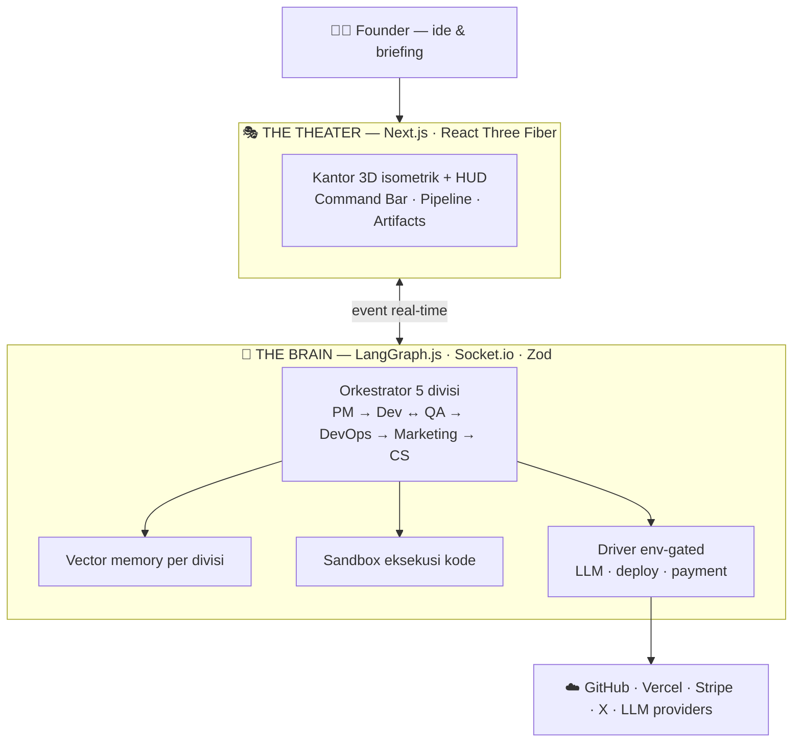

# AutoOffice3D — Autonomous 3D AI Virtual Office

> **The Theater & The Brain.** Satu kantor virtual pribadi yang dihuni oleh tim AI: Founder cukup mengide, seluruh tim (PM, Dev, QA, DevOps, Marketer, CS) bekerja sendiri — dan semuanya tampil **real-time di kantor 3D isometrik** di browser.

## Project ini apa?

AutoOffice3D adalah **kantor virtual pribadi** milik Founder — satu perusahaan software yang beroperasi **full-agent**. Office-nya sendiri bukan produk yang dijual; yang dijual adalah **produk hasil generate** di dalamnya (landing page, micro-SaaS, custom app) kepada client nyata.

Alurnya:

```
Ide Founder → BRIEFING (diskusi multi-turn sama PM) → GO
   → BUILD otonom (PM → Dev ↔ QA → DevOps) → produk jadi + repo GitHub + deploy
   → MARKETING (kampanye sosial → leads)
   → SALES (CS Agent: jawab client, follow-up, quote)
   → COMMERCE (payment link Midtrans/Stripe + kontrak PDF) → DEAL → production
```

- **The Brain** (`brain/`) — daemon backend: orkestrasi LangGraph, memori vector RAG, sandbox eksekusi kode, driver LLM & integrasi cloud.
- **The Theater** (`theater/`) — HUD web Next.js + React Three Fiber: kantor 3D low-poly isometrik 5 zona, tiap aksi agen direfleksikan sebagai avatar berjalan/mengetik bicara lewat speech bubble, lengkap dengan Founder Command Bar untuk mengeluarkan instruksi.

Semua driver **env-gated** — tanpa API key apa pun, sistem tetap jalan penuh memakai driver `stub` / `memory` / `local` (offline, deterministik). Begitu kredensial diisi di `brain/.env`, driver otomatis berganti ke yang produksi (`anthropic`, `pinecone`, `vercel`, `e2b`, dsb).

## Kenapa ini keren

- **🤖 Tim AI yang beneran kerja** — bukan satu chatbot: ada PM yang menyusun PRD, Dev yang menulis kode, QA yang menjalankan test deterministik, DevOps yang push ke GitHub & deploy, Marketer yang bikin kampanye, sampai CS yang menutup penjualan. Semuanya otonom setelah Founder menekan GO.
- **🏢 Kantornya nyata (versi 3D)** — seluruh kantor isometrik low-poly tampil live di browser: agen berjalan antar zona, mengetik di meja, speech bubble menampilkan log aksi, dan seluruh kantor ikut konfeti saat penjualan pertama masuk.
- **⏸️ Bisa dijeda & dilanjutkan** — run yang sedang berjalan bisa di-halt kapan saja, lalu di-resume dari state tersimpannya (checkpointer LangGraph) tanpa mengulang dari nol.
- **🧩 Jalan tanpa API key** — semua komponen punya driver offline/stub yang deterministik; sistem bisa dicoba penuh di laptop tanpa biaya, lalu "menyala" ke mode produksi cukup dengan mengisi `.env`.
- **🔒 Anggaran token terjaga** — guard 250 ribu token per run dengan hard-kill, plus circuit breaker 5 siklus pada loop Dev↔QA agar iterasi nggak membakar token tanpa batas.

## Tech Stack

| Layer | Teknologi |
|---|---|
| **Brain (backend)** | Node.js + TypeScript strict · [LangGraph.js](https://langchain-ai.github.io/langgraphjs/) (state machine orkestrasi) · Socket.io · Zod |
| **Theater (frontend)** | Next.js App Router · React Three Fiber + drei (Three.js) · Zustand · Tailwind CSS |
| **AI & Memori** | Driver pattern LLM (Anthropic-compatible API / gateway lokal 9router) · Vector memory per divisi · OpenAI embeddings + fallback deterministik |
| **Sandbox & Quality** | Isolasi eksekusi kode (E2B / local exec) · Vitest + coverage ≥ 90% · ESLint + Prettier · `tsc --noEmit` strict |
| **Integrasi Cloud** | GitHub API · Vercel · Stripe · X/Twitter · (Midtrans/Xendit menyusul) |

Semua integrasi bersifat **driver pattern + env-gated**: mode stub/offline untuk pengembangan tanpa biaya, begitu kredensial diisi tinggal berganti driver tanpa menyentuh kode bisnis.

## Arsitektur



Dua app terpisah per folder — komputasi AI (Brain) tidak bercampur dengan rendering 60 FPS (Theater) — berkomunikasi semata-mata lewat event Socket.io, sehingga masing-masing bisa dirilis dan diskalakan independen.

## Struktur repository

```
auto-office-3d/
├── brief/                  # Dokumen spesifikasi (PRD = SSOT) + referensi UI (read-only)
│   └── master_prd_architecture_brief_autooffice3d.md
├── brain/                  # THE BRAIN — backend daemon otonom
│   ├── scripts/            # Utilitas (benchmark model, dll)
│   └── src/
│       ├── config.ts       # Env config tervalidasi (zod)
│       ├── types.ts        # Kontrak payload (agent:status_update, milestone:first_sale, chat)
│       ├── events.ts       # Event bus in-process (di-subscribe Socket.io)
│       ├── run.ts          # Jalankan 1 run otonom penuh dari satu prompt
│       ├── graph/          # LangGraph state machine — 5 divisi + circuit breaker
│       ├── control.ts      # HALT / RESUME run (Loop Controls)
│       ├── memory/         # Vector memory (driver: pinecone / in-memory) + embeddings
│       ├── llm/            # LLM provider (Anthropic / stub deterministik)
│       ├── sandbox/        # Isolasi eksekusi kode (E2B / local exec) + security guard
│       ├── integrations/   # GitHub, Vercel, Stripe (webhook sentinel), X/Twitter
│       ├── telemetry/      # Token budget guard (250k/run)
│       └── server/         # Socket.io realtime protocol
├── theater/                # THE THEATER — frontend Next.js + React Three Fiber
│   ├── app/                # App Router
│   ├── components/
│   │   ├── scene/          # OfficeScene, Floor, ZoneMatrix, Furniture, NeuralBus
│   │   ├── shell/          # AppShell + Founder Command Bar
│   │   ├── pipeline/       # Telemetry pipeline (teks)
│   │   ├── artifacts/      # Artefak run (PRD, kode, hasil QA)
│   │   └── overlays/       # PerfOverlay, CelebrateOverlay, dll
│   ├── store/              # Zustand — state real-time dari socket
│   ├── lib/zones.ts        # Kontrak zone matrix (duplikat terkontrol dari PRD §4.1)
│   └── tests/              # Test kontrak zona & kamera
```

## Menjalankan

```bash
# THE BRAIN
cd brain
npm install
npm test                # unit + integration (94 test)
npm run test:coverage   # + coverage (target ≥ 90% statement)
npm run typecheck       # tsc --noEmit (strict)
npm run simulate        # 1 prompt Founder → run otonom penuh (mode stub, tanpa API key)
npm run dev             # Socket.io daemon di ws://localhost:4800/brain-server

# THE THEATER
cd theater
npm install
npm run dev             # kantor 3D di http://localhost:3000
npm test                # kontrak zona/kamera (59 test)
npm run build           # next build (produksi)
```

Cara paling cepat mencoba: jalankan Brain (`npm run dev`), jalankan Theater (`npm run dev`), lalu ketik satu ide di **Founder Command Bar** (footer) — tekan Enter, dan lihat tim agen 3D mulai bekerja.

## Dokumen & referensi

- **Single Source of Truth (PRD):** [`brief/master_prd_architecture_brief_autooffice3d.md`](brief/master_prd_architecture_brief_autooffice3d.md)
- **Design system:** [`brief/autonomous_command_hud/DESIGN.md`](brief/autonomous_command_hud/DESIGN.md)
- **Referensi visual:** `brief/<view>/code.html` + `screen.png` (6 view)
- **ADR (keputusan teknis):** [`docs/ADR/`](docs/ADR)
- **Bench LLM terakhir:** [`bench/latest.md`](bench/latest.md)
- **Panduan agen:** [`AGENTS.md`](AGENTS.md)
- **Task board:** https://trello.com/b/RbCtUakd
