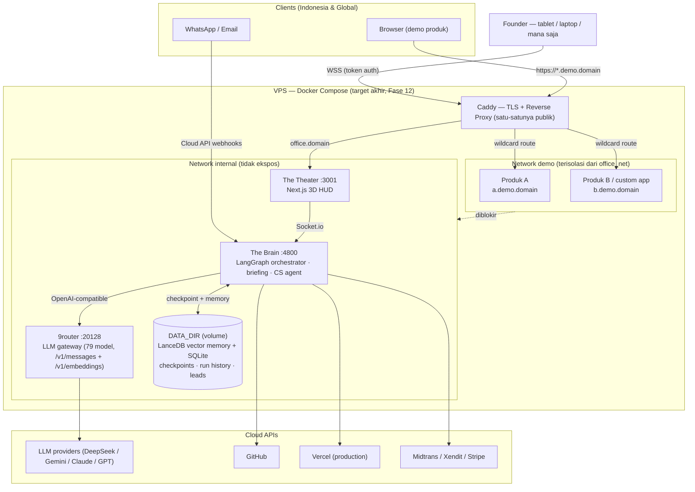
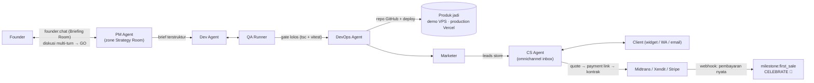

# 📑 MASTER PRODUCT REQUIREMENT DOCUMENT (PRD) & TECHNICAL BRIEF
**Project Name:** AutoOffice3D — Autonomous 3D AI Virtual Office (The Theater & The Brain)  
**Document Version:** 3.0 (Company Edition — Durability, Commerce & CS Loop)  
**Author:** AI Systems Architect & Product Team  
**Status:** Approved for Implementation  
**Execution Paradigm:** 100% Unattended Autonomous Execution (Zero-Human-in-the-Loop post Founder Prompt — termasuk fase *Briefing* diskusi PM sebelum run dimulai)

---

## 1. Executive Summary & Vision

### 1.1 Product Vision
**AutoOffice3D** adalah *kantor virtual pribadi* milik Founder: satu perusahaan software solution yang beroperasi **full-agent**. AutoOffice3D itu sendiri **bukan produk yang dijual** — melainkan mesin inkubasi: ide Founder dinegosiasikan dengan PM, di-build oleh Dev/QA/DevOps, dipasarkan oleh Marketer, lalu ditutup penjualannya oleh CS Agent. Yang dijual adalah **portofolio produk hasil generate** (landing page, micro-SaaS, custom app) kepada client nyata.

Kantor ini hidup **24/7 di VPS** (Docker), diakses Founder dari tablet/laptop kapan saja; demo produk ke client dijalankan per-instance di subdomain wildcard, dan deal ditutup dengan payment link + kontrak yang diterbitkan CS Agent.

Seluruh dinamika dan komunikasi antar-agen tersebut direfleksikan secara instan dan *real-time* ke dalam antarmuka 3D isometrik web (*The Theater*) bergaya modern low-poly.

### 1.2 Business Operating Model
```
IDE (Founder) → BRIEFING (diskusi PM, multi-turn) → APPROVE ("GO") → BUILD otonom (PM→Dev→QA→DevOps)
      → MARKETING (Marketer → leads) → SALES (CS Agent: tanya jawab, follow-up, quote)
      → COMMERCE (payment link Midtrans/Stripe + kontrak PDF) → DEAL → PRODUCTION (Vercel/live)
```
* **Diskusi dulu, otonom kemudian:** fase briefing adalah bagian dari "Founder Prompt" — begitu tombol GO ditekan, eksekusi kembali 100% tanpa intervensi.
* **Leads pipeline:** Marketer menaruh leads ke store bersama; CS Agent mengeksekusi (jawab, follow-up terjadwal, quote) hingga deal.
* **Multi-gateway:** market Indonesia → Midtrans/Xendit (QRIS, VA, e-wallet); market internasional → Stripe.

### 1.3 Target Milestones & Success Criteria (Definition of Done)
1. **Zero-Touch Delivery:** Dari 1 instruksi teks Founder hingga aplikasi online dengan URL Vercel aktif tanpa tombol persetujuan manusia manual.
2. **Deterministic QA Loop:** Dev dan QA agen beriterasi memperbaiki *type error* & unit test hingga skor kelulusan 100% dengan perlindungan *Circuit Breaker*.
3. **Persistent Memory Recall:** Agen berhasil menyimpan sintesis kerja ke Vector DB dengan cosine similarity > 0.85 untuk penggunaan siklus berikutnya.
4. **Interactive 3D Telemetry Synchronization:** R3F/Three.js frontend mencerminkan status koordinat, animasi berjalan, mengetik, dan selebrasi dengan latensi soket < 50ms.
5. **Monetization Event Loop:** Penangkapan webhook pembayaran (`checkout.session.completed` / notifikasi Midtrans) yang secara otomatis memicu mode selebrasi global (*Celebration State*).
6. **Restart-Safe Office:** Seluruh memory RAG, checkpoint graph, dan riwayat run **durable di disk** (`DATA_DIR`) — restart container/VPS = kantor *resume*, bukan reset.
7. **Briefing Before Autonomy:** Founder dapat berdiskusi multi-turn dengan PM (Briefing Room) sebelum run otonom dimulai; hasil diskusi terkompilasi jadi brief terstruktur.
8. **Real Commerce Close:** CS Agent menerbitkan payment link (Midtrans Snap / Stripe) + kontrak PDF dari deal hasil percakapan client — milestone first-sale dapat dipicu oleh pembayaran **nyata**, bukan simulasi.

---

## 2. System Architecture & Topology

Sistem dibagi secara tegas menjadi dua repositori independen (*Decoupled Non-Monorepo*) untuk memisahkan beban komputasi AI dengan performa rendering grafis 60 FPS:

```
┌────────────────────────────────────────────────────────┐
│               THE BRAIN (Backend Daemon)               │
│  LangGraph.js Orchestrator + Isolated Sandbox (E2B)    │
│  Vector Memory (LanceDB embedded · Pinecone optional)  │
│  Durable State: DATA_DIR (SQLite checkpoints + runs)   │
└──────────────────────────┬─────────────────────────────┘
                           │ Socket.io Event Stream
                           │ (Telemetry & State Diffs)
┌──────────────────────────▼─────────────────────────────┐
│              THE THEATER (Frontend Web HUD)            │
│  Next.js + React Three Fiber + Tailwind CSS            │
│  Low-Poly 3D Office + Briefing Room + Run History      │
└────────────────────────────────────────────────────────┘
```

### 2.1 Backend Repository: `brain/`
* **Framework:** Node.js (TypeScript) + LangGraph.js State Machine.
* **LLM Engine (Driver Pattern):** `createLLM` memilih driver via env `LLM_DRIVER=stub|anthropic` (auto → Anthropic-compatible bila key tersedia). Base URL dapat di-override (`ANTHROPIC_BASE_URL`) sehingga kompatibel dengan gateway lokal **9router** (`/v1/messages`) maupun API resmi Anthropic. Strategi model berjenjang (tier): model gratis/termurah didahulukan (benchmark menentukan pemenang, lihat §7 Fase 7).
* **Embeddings:** OpenAI `text-embedding-3-small` (driver `OPENAI_*`) dengan fallback `HashEmbedder` deterministik untuk mode offline/stub.
* **Code Sandbox:** E2B / Fly Machines isolated micro-VMs (menjalankan `npm install`, compile, Vitest headless) dengan timeout 60s.
* **Vector Memory (Driver Pattern):** driver `lancedb` (**default — embedded, durable, zero-server**) atau `pinecone` (cloud, opsional). Partisi namespace:
  * `pm-memory`: Standar PRD, user persona, benchmarking.
  * `dev-memory`: Template arsitektur kode, boilerplate Next.js/Stripe.
  * `qa-memory`: Edge-case test cases, anti-patterns.
  * `marketing-mem`: Formula copywriting viral, metrik engagement.
  * `briefing`: Histori diskusi Founder↔PM & percakapan client↔CS (Fase 8/11).
* **Durability Contract (`DATA_DIR`):** seluruh state durable berada di satu folder (default `brain/data/`): SQLite (checkpoint LangGraph via `@langgraph/checkpoint-sqlite`, riwayat run, event log) + folder LanceDB. Saat pindah VPS, folder ini di-*mount* menjadi Docker volume — restart = resume, bukan reset.
* **Realtime Protocol:** Socket.io Server (WebSockets + polling fallback) dengan enkripsi WSS.
* **Cloud API Integrations:** GitHub REST API v3, Vercel Edge API, Payment Gateway (Stripe/Midtrans/Xendit), WhatsApp Cloud API, email (Resend outbound + inbound adapter), X/Twitter API v2.

### 2.2 Frontend Repository: `theater/`
* **Framework:** React 18+ (Next.js App Router) + TypeScript.
* **3D Viewport:** React Three Fiber (R3F) / Three.js r128+ + `@react-three/drei`.
* **State Management:** Zustand (Sinkronisasi store real-time dari Socket.io payload).
* **Styling & Design System:** Tailwind CSS v3, Plus Jakarta Sans, Palet Dark HUD `#051424`.
* **Audio FX:** Web Audio API (Ambient typing, hum server, fanfare chime saat transaksi pertama).

### 2.3 Deployment Topology & Target Environment
Periode pengembangan berjalan **lokal di mesin Founder** (Brain `:4800`, Theater `:3001`) — setiap fase wajib lolos soak test lokal beberapa minggu sebelum migrasi. Target akhir: **satu VPS menjalankan seluruh kantor via Docker Compose**:

* **Network internal** (`brain`, `theater`, `9router`) — tidak diekspos langsung ke publik.
* **Caddy** sebagai satu-satunya entry publik: TLS otomatis, `office.<domain>` → Theater (dilindungi token auth), `*.demo.<domain>` → container produk hasil generate (wildcard Let's Encrypt).
* **Network demo terisolasi** — container client tidak boleh dapat menjangkau Brain dari dalam jaringan Docker (*blast-radius* maksimal per produk).
* **9router** dijalankan via image resmi `decolua/9router` sebagai LLM gateway (opsional; fallback = API key langsung).



Catatan pemisahan tanggung jawab deployment: **VPS/Docker = demo & staging** produk hasil generate (murah, bisa di-spin up/down), **Vercel = production** setelah client deal (via integrasi DevOps yang sudah ada).

---

## 3. Multi-Agent State Machine & Division Specifications

Alur kerja backend diatur oleh Graf Siklus LangGraph dengan 5 divisi otonom. *Orchestrator* = runner graf LangGraph (thread checkpointed & resume-able), PM sebagai muka diskusi Founder:



### 3.1 Division 1: Product Management (PM Agent)
* **Briefing Phase (Fase 8 — diskusi dulu, otonom kemudian):** sebelum run dimulai, Founder dapat berdiskusi multi-turn dengan PM lewat event `founder:chat` (Briefing Room). PM mengajukan pertanyaan klarifikasi, menawarkan alternatif arsitektur/bisnis, dan merecall memori run sebelumnya (namespace `briefing` + `pm-memory`). Percakapan disimpan durable. Tombol **GO** di UI mengompilasi hasil diskusi menjadi brief terstruktur (`founder:directive` + konteks briefing) → graf otonom berjalan tanpa intervensi lanjutan. *Command bar* (Fase 6) tetap tersedia sebagai fast-path tanpa diskusi.
* **Trigger Input:** Founder raw string (misal: *"Micro-SaaS invoice generator with Stripe integration"*) atau brief hasil briefing.
* **RAG Retrieval:** Query ke namespace `pm-memory` untuk mengambil pola arsitektur serupa.
* **Preset Selection:** PM memilih *project preset* produk — `landing` | `saas-fullstack` | `custom-app` (tier-1 TypeScript/Node; gate & Docker template mengikuti preset).
* **Output Artifact:** Berkas `specs/PRD-AutoInvoice.md` berformat markdown berisi:
  * Executive Summary & Target Audience
  * Functional User Stories (US-801, US-802, etc.)
  * TypeScript Data Contract / Interface definitions
  * Acceptance Criteria (AC).

### 3.2 Division 2: Full-Stack Engineering & QA Loop
* **Engineering Dev Agent:**
  * Membaca `PRD-AutoInvoice.md`.
  * Menghasilkan struktur berkas proyek (`src/routes`, `src/components`, `src/lib/stripe.ts`).
  * Mengirimkan diff kode ke sandbox runner.
* **QA Test Runner Agent:**
  * Mengeksekusi `vitest run --coverage` di dalam sandbox.
  * Memeriksa type-safety TypeScript (`tsc --noEmit`).
  * Jika terjadi kegagalan (test failed / compile error): Log error dikembalikan ke Dev Agent dengan counter iterasi bertambah (`Cycle N/5`).
* **Circuit Breaker Guardrail:**
  * Batas iterasi maksimal: **5 siklus**.
  * Jika siklus ke-5 masih gagal, sistem memotong eksekusi dan mengaktifkan fallback safe-build untuk mencegah pemborosan token (*token bleed*).

### 3.3 Division 3: DevOps & Autonomous Deployment
* **GitHub Repository Provisioning:** Membuat repositori publik baru secara terprogram via API (`POST /user/repos`), commit kode, dan push ke branch `main`.
* **Demo Deployment — `DEPLOY_DRIVER=docker` (Fase 10):** mem-*build* Dockerfile dari bundle hasil codegen (preset `landing`/`saas-fullstack`/`custom-app`), menjalankan container di network demo VPS, dan mendaftarkan subdomain `produk.demo.<domain>` ke Caddy. Instance demo dapat di-spin up/down (TTL/resource saving). Berlaku lokal terlebih dahulu (Docker Desktop) sebelum VPS.
* **Vercel Edge Deployment (Production):** Memicu deployment via Vercel API hook, memantau build status (`READY`), dan mengekstrak `live_url` (contoh: `invoiceai-gen.vercel.app`). Dipakai ketika client deal (promosi demo → production).
* **Health Check Probe:** Memverifikasi HTTP status 200 OK pada endpoint root dan endpoint API sebelum menandai deployment sukses.

### 3.4 Division 4: Growth, Marketing & Revenue Sentinel
* **Social Campaign Dispatcher:**
  * Menyusun posting pengumuman peluncuran produk dan hook *Build-in-Public*.
  * Mengirimkan thread ke Twitter/X API dan Meta Threads.
* **Leads Handoff:** setiap interaksi/peminat yang terdeteksi ditulis ke *leads store* bersama (SQLite + namespace vector `leads`) dengan skema `Lead { id, source, contact, interest, status: new|contacted|qualified|deal|lost, next_followup_at }` — siap dieksekusi CS Agent (§3.5).
* **Payment Sentinel (Multi-Provider):**
  * `PAYMENT_DRIVER=stub|stripe|midtrans|xendit` — abstraksi `PaymentProvider` dengan verifikasi signature webhook masing-masing (Stripe: HMAC-SHA256; Midtrans: SHA-512 `order_id+status_code+gross_amount+serverKey`) dan normalisasi ke payload `first_sale` yang sama. **Status Fase 9:** driver `stub|stripe|midtrans` aktif (`brain/src/payments/`), `xendit` masih kerangka interface; webhook masuk lewat `POST /webhook/<driver>` dengan status `200/400/401/501`; demo tanpa akun memakai driver `stub` (`/demo/checkout` + `/demo/pay`).
  * Memantau metrik pengunjung aktif dan konversi keranjang.
  * Begitu terdeteksi transaksi pertama ($29.00 ARR atau nominal IDR setara):
    1. Mengubah state global `hasCustomers = true`.
    2. Menyiarkan event `CELEBRATE` ke Socket.io.
    3. Mengirimkan email konfirmasi selamat datang otomatis ke pembeli.

### 3.5 Division 5: Customer Success (CS Agent)
* **Omnichannel Inbox (Fase 11):** adapter per channel menormalkan pesan masuk menjadi satu format event:
  * **Web widget** — client yang sedang mencoba produk demo mengobrol langsung dari halaman demo (via socket).
  * **WhatsApp Business (Cloud API)** — webhook pesan masuk; *constraint*: pesan outbound di luar jendela 24 jam sejak balasan terakhir wajib berupa template HSM yang disetujui Meta.
  * **Email** — adapter inbound terpisah (Mailgun/Postmark inbound webhook atau poller IMAP; Resend untuk outbound).
* **Follow-Up Engine (mini-CRM):** scheduler Brain menyapu leads dengan `next_followup_at` terlewat → CS Agent menyiapkan/mengirim pesan tindak lanjut (template WA / email) sesuai status lead.
* **Closing Flow:** saat client deal → CS menerbitkan **payment link** (Midtrans Snap / Stripe Payment Link — halaman bayar hosted, tanpa form kartu sendiri) + **kontrak PDF** dari template (data client/produk/harga terisi otomatis) → dikirim via channel yang sama.
* **Memory & Handshake:** percakapan client disimpan di namespace `briefing`; ringkasan deal di-upsert ke `pm-memory` sehingga run berikutnya tahu konteks client.

---

## 4. 3D Virtual Theater Technical Specifications

### 4.1 Zone Coordinates Matrix (The Map)
Ruang kantor dimodelkan dalam sistem grid isometrik 3D berukuran 60x60 unit dengan origin (0,0,0) di pusat Neural Bus:

| Zona ID | Nama Zona | Koordinat (X, Y, Z) | Dimensi (W x D) | Aksen Warna | Divisi Penghuni |
| :--- | :--- | :---: | :---: | :---: | :--- |
| `zone_01` | Founder Desk | `(-14, 0.4, 14)` | 10 x 10 | `#6366f1` (Indigo) | Founder Avatar |
| `zone_02` | Strategy / Meeting Room | `(-13, 0.4, -13)` | 12 x 11 | `#f59e0b` (Amber) | PM Agent & Brainstorming |
| `zone_03` | Core Dev & QA Lab | `(14, 0.4, -12)` | 14 x 12 | `#10b981` (Emerald) | Dev Agent & QA Runner |
| `zone_04` | Creative & Marketing Studio | `(14, 0.4, 12)` | 12 x 11 | `#ec4899` (Pink) | Growth & Social Agent |
| `zone_05` | DevOps & Cloud Hub | `(0, 0.4, 16)` | 8 x 8 | `#06b6d4` (Cyan) | Infra & Server Racks |
| `hub_00` | Central Neural Bus | `(0, 0.4, 0)` | 8 x 8 | `#38bdf8` (Sky) | Hologram Router |

### 4.2 Low-Poly Bipedal Character Rigs & Animation States
Karakter agen dibangun dengan geometri modular low-poly (*box-man*), terdiri dari:
* **Body:** Kubus torso dengan rompi warna divisi.
* **Glowing Head:** Kubus kepala ber-emissive shader yang intensitas pendarannya meningkat saat berpikir/mengetik.
* **Limbs:** Lengan dan kaki dengan pivot sendi untuk siklus berjalan (*walking cycle*) dan mengetik (*working cycle*).
* **Floating Speech Bubble:** Overlay 2D/3D billboard di atas kepala agen yang menampilkan log aksi langsung.

#### State Matrix:
1. `IDLE`: Agen duduk di kursi meja masing-masing dengan osilasi pernapasan halus (*subtle sine wave* Y: ±0.03).
2. `WORKING`: Tangan agen mengayun mengetik pada keyboard meja, emisi kepala berdenyut dengan frekuensi 8Hz.
3. `WALKING`: Interpolasi posisi linier (Lerp) dari koordinat asal ke target waypoint dengan ayunan kaki berlawanan arah (*stride swing*).
4. `CELEBRATE`: Dipicu saat `hasCustomers = true`. Semua agen berkumpul di Central Hub, melompat berulang kali (Y: +1.4), dan memancarkan partikel konfeti.

### 4.3 Camera Viewport & Controls
* **Default Isometric Angle:** `Position(38, 30, 42)`, `LookAt(0, 0, 0)`, FOV 40°.
* **Orbit Controls:** Smooth damping rotation dengan batasan polar angle (0.2 hingga π/2.2).
* **Cinematic Presets:**
  * `Overview`: Tampilan menyeluruh 5 zona kantor.
  * `Founder`: Kamera fokus ke Meja Founder saat pengetikan prompt awal.
  * `Dev Lab`: Kamera zoom ke meja Dev & QA saat iterasi build berlangsung.
  * `Meeting`: Kamera fokus ke Meja Bundar saat fase diskusi PM.

### 4.4 HUD Components & Views (v3.0)
* **Founder Command Bar (Fase 6 — selesai):** input sticky di footer semua tab; mengirim `founder:directive` + ack, riwayat 8 prompt terakhir, preset kamera `Founder` otomatis. Ruang footer dihitung via ResizeObserver (`--shell-bottom-space`) agar tidak tertimpa overlay.
* **Briefing Room (Fase 8):** panel percakapan thread (avatar PM) untuk diskusi multi-turn; tombol **"GO — mulai run otonom"** di akhir thread. Berbagi infra percakapan dengan CS Inbox.
* **Run History (Fase 7):** tab/panel riwayat run dari SQLite — bertahan setelah restart browser maupun server.
* **CS Inbox (Fase 11):** daftar percakapan client per channel (widget/WA/email) + status lead + aksi cepat (quote, payment link, kirim kontrak).

---

## 5. Real-Time Telemetry Protocol (Socket.io Schema)

### 5.1 Event: `agent:status_update`
Dikirimkan dari backend setiap kali agen berpindah state atau menghasilkan progres baru:

```typescript
interface AgentStatusPayload {
  runId: string;
  agentId: 'founder_agent' | 'pm_agent' | 'dev_agent' | 'qa_agent' | 'devops_agent' | 'marketing_agent';
  division: 'Product' | 'Engineering' | 'QA' | 'DevOps' | 'Growth';
  currentAction: 'idle' | 'walking' | 'discussing' | 'coding' | 'testing' | 'deploying' | 'marketing' | 'celebrating';
  targetZone: 'founder_desk' | 'meeting_room' | 'dev_lab' | 'marketing_studio' | 'devops_hub' | 'central_bus';
  coordinates?: { x: number; y: number; z: number };
  logMessage: string;
  iterationCycle?: { current: number; max: number };
  telemetry: {
    tokensUsed: number;
    latencyMs: number;
    model: string;
  };
  timestamp: string;
}
```

### 5.2 Event: `milestone:first_sale`
Memicu selebrasi kantor global:

```typescript
interface FirstSalePayload {
  runId: string;
  customer: {
    city: string;
    country: string;
    maskedEmail: string;
  };
  amount: number; // e.g. 29.00
  currency: 'USD' | 'IDR';
  paymentProvider: 'stripe' | 'midtrans' | 'xendit' | 'stub';
  paymentEventId: string;
  hasCustomers: true;
  timestamp: string;
}
```

### 5.3 Event: `founder:chat` / `pm:reply` (Fase 8)
Kanal percakapan multi-turn Founder↔PM (dan CS↔client dengan namespace chat sama):

```typescript
interface ChatTurnPayload {
  conversationId: string;
  channel: 'briefing' | 'cs_widget' | 'cs_whatsapp' | 'cs_email';
  role: 'human' | 'agent';
  agentId?: 'pm_agent' | 'cs_agent';
  message: string;
  citations?: string[]; // recall dari vector memory
  timestamp: string;
}
// Client → Server : founder:chat { conversationId, message }
// Server → Client : pm:reply   { ...ChatTurnPayload, role: 'agent', agentId: 'pm_agent' }
```

### 5.4 Event: `payment:link_created` (Fase 9/11)
Dipublikasikan ketika CS Agent menerbitkan payment link untuk sebuah deal:

```typescript
interface PaymentLinkPayload {
  leadId: string;
  provider: 'stripe' | 'midtrans' | 'xendit' | 'stub';
  checkoutUrl: string;      // hosted payment page (Snap / Payment Link)
  amount: number;
  currency: 'USD' | 'IDR';
  contractUrl?: string;     // URL kontrak PDF hasil generate
  expiresAt?: string;
  timestamp: string;
}
```

---

## 6. Security, Sandboxing & Risk Mitigations

1. **Host Isolation:** Kode yang ditulis oleh Dev Agent tidak pernah dijalankan di OS mesin backend. Semua eksekusi `node`, `vitest`, dan `npm` wajib diisolasi di container E2B/gVisor sandboxed dengan akses jaringan terbatas.
2. **API Key Vault:** Kredensial Vercel, GitHub, Stripe, dan Twitter disimpan dalam vault memori terenkripsi AES-256 dan hanya diinjeksi ke instance runner per-tugas.
3. **Prompt Injection & Code Poisoning Guard:** Validasi sintaks AST statis terhadap kode sebelum pengujian untuk mencegah pembacaan file sistem lokal atau exfiltrasi env var host.
4. **Token Bleed Protection:** Batas pengeluaran token maksimum per run ditetapkan sebesar 250.000 tokens dengan hard-kill jika terlampaui.
5. **VPS Public Access Auth (Fase 12):** Theater di VPS wajib dilindungi token/basic auth + rate limit; Brain tidak diekspos langsung (hanya melalui jaringan Docker internal). Token budget guard tetap menjadi benteng terakhir biaya.
6. **Demo Network Isolation (Fase 10/12):** container produk demo berjalan di Docker network terpisah dan **diblokir menjangkau Brain/9router/DATA_DIR** — kompromi satu demo tidak membahayakan kantor.

---

## 7. Delivery Roadmap & Checklist Implementasi

> Status per PRD v3.0: **Fase 1–11 selesai & merged** (Brain 248/248 test, Theater 98/98 test, e2e smoke browser PASS termasuk event replay + closing CS lewat widget) + hardening pra-Fase 8 (AGENTS.md, root scripts, CI GitHub Actions, e2e smoke, fail-fast config). Fase 12–13 adalah komitmen berikutnya. Seluruh fase berlangsung **lokal di mesin Founder** terlebih dahulu; soak test beberapa minggu menjadi prasyarat migrasi VPS (Fase 12).

| Fase | Status | Deliverable Utama |
| :--- | :---: | :--- |
| **Fase 1: State Machine & Backend Daemon** | ✅ Selesai | • LangGraph.js graph & router divisi<br>• Memory driver (stub, offline-first)<br>• Sandbox runner deterministik |
| **Fase 2: 3D Isometric Viewport & Scene** | ✅ Selesai | • Geometri kantor & zona koordinat<br>• Karakter low-poly bipedal & state animasi<br>• Kamera orbit & preset |
| **Fase 3: Socket.io Real-Time Synchronization** | ✅ Selesai | • Pipeline event stream ke store frontend<br>• Sinkronisasi speech bubble & koordinat agen |
| **Fase 4: External Integrations & Revenue Loop** | ✅ Selesai | • GitHub + Vercel auto-deploy<br>• Stripe webhook sentinel (simulasi $29 ARR) |
| **Fase 5: Polish & End-to-End Testing** | ✅ Selesai | • Run end-to-end otonom penuh<br>• Optimasi render & stabilitas |
| **Fase 6: Founder Command Bar** | ✅ Selesai | • Input manusia tunggal di semua tab<br>• `founder:directive` + ack + riwayat prompt |
| **Fase 7: Durability + Evaluasi Model** | ✅ Selesai | • `DATA_DIR` contract; LanceDB driver (vector memory durable); SQLite checkpoint (`@langgraph/checkpoint-sqlite`) + resume run terputus; run-history & event log<br>• Unit test `AnthropicLLM` (mock fetch); wiring `ANTHROPIC_BASE_URL`/`OPENAI_BASE_URL`; `.env.example`<br>• Script benchmark `bench-llm.mjs`: N run/model → % lolos gate tsc+vitest, latensi, token — tier 0 (free) → tier 1 murah (DeepSeek 4.1 Flash duluan) → tier 2/3 hanya jika < 80% lolos |
| **Fase 8: Briefing Room** | ✅ Selesai | • Event `founder:chat` → `pm:reply` sesuai kontrak `ChatTurnPayload` (PRD §5.3) + `briefing:history`; ack konsisten dengan `founder:directive`<br>• Namespace vector `briefing` durable (LanceDB) + API `list` kronologis (`seq`) — percakapan selamat restart<br>• PM Briefing Agent: LLM task `briefing` (recall `briefing`+`pm-memory` → citations) & task `brief` (compile brief terstruktur: audience/fitur/preset/harga, heuristik deterministik saat stub/non-JSON)<br>• UI tab Briefing Room: bubble thread + avatar PM + typing indicator + tombol GO (disabled saat thread kosong) → compile brief → `founder:directive` (+brief masuk `pm-memory`) → run otonom penuh; Command bar tetap fast-path<br>• Test: unit chat flow + integrasi socket E2E (diskusi → GO → milestone) + smoke browser diperluas |
| **Fase 9: Payment Abstraction** | ✅ Selesai | • `PaymentProvider` interface (`createPaymentLink`, `receiveWebhook` → `FirstSalePayload`) + factory `createPayment` (pola `createLLM`); driver **stub** (demo lokal), **stripe** (HMAC-SHA256 + Payment Links), **midtrans** (Snap hosted + notifikasi SHA-512 + tolerance replay), **xendit** (kerangka interface, isi di Fase 11) — `PAYMENT_DRIVER=auto\|stub\|stripe\|midtrans\|xendit` fail-fast tanpa kredensial<br>• Kontrak §5.2 diperbarui: `FirstSalePayload.paymentProvider` + `paymentEventId` (menggantikan `stripeEventId`), `currency USD\|IDR`, field `currency` di `revenue:update`; idempotensi lintas provider per event id<br>• Webhook per driver `POST /webhook/<driver>` (200/400/401/501) + demo stub `GET /demo/checkout` → `POST /demo/pay` (simulasi bayar → `milestone:first_sale`); event socket `payment:simulate` menggantikan `stripe:simulate`<br>• Pecah `server/socket.ts` → `server/http.ts` (health/control/webhook/demo) + `server/socket.ts` (bootstrap + io handlers); `/health` diperkaya status payment sentinel<br>• Test: stripe dimigrasi + midtrans (signature/mapping/tolerance/Snap) + stub demo + factory; e2e smoke browser diperluas (Simulate Payment → milestone + CELEBRATE) |
| **Fase 10: Demo Harness** | ✅ Selesai* | • Preset stack tier-1 `brain/src/products/presets/`: `landing` (port 4173) / `saas-fullstack` (3000, Dockerfile multi-stage npm) / `custom-app` (8080) — masing-masing punya Dockerfile template + gate sendiri (`RUN node selftest.mjs`, dijalankan saat image build); PM memilih preset dari brief (`Preset stack:` eksplisit → keyword → default `saas-fullstack`) → `state.preset`<br>• `DEPLOY_DRIVER=docker` (`brain/src/integrations/dockerdeploy.ts`): render stack + tulis build context (bundel codegen terisolasi di `codegen/` + `provenance.json`) → `docker build` → `docker run` di network `demo-net` (tanpa volume; `--add-host=host.docker.internal:0.0.0.0`; cap-drop; memory/cpu limit; label `autooffice3d.*` siap Caddy Fase 12) → health probe `/health` HTTP 200 sebelum status READY; spin up/down (`spinDown` = `docker rm -f`); degradasi rapi bila daemon mati (`degradedReason`); exec injectable → diuji tanpa daemon<br>• Routing subdomain lokal: mapping port host `4510–4599` (+ `DEPLOY_PUBLISH_HOST`/`DEPLOY_PROBE_HOST` untuk compose office stack); label `autooffice3d.route=demo.<slug>.localhost`<br>• Event replay: `run_events` (ascending) → socket `run:replay` (frame `start → event* → end`, ack `{total, stepMs}`, cancel per socket) → panel Theater "Run Replay · Event Log" (daftar run durable + progress + timeline, tombol ▶/⏹)<br>• `brain/Dockerfile` + `theater/Dockerfile` (standalone) + `docker-compose.yml` (brain/theater/Caddy, network `office`+`demo-net`) + `deploy/Caddyfile` (vhost office; wildcard demo disiapkan Fase 12); gate `npm run e2e:docker` (smoke 3 preset: akses produk + isolasi + spin down)<br>• Test: preset (gate via `node selftest`, heuristik preset) + DockerDeploy (fake exec, tanpa Docker) + replay socket & store; e2e smoke browser diperluas (observer replay + playback UI)<br>*Verifikasi smoke Docker Desktop lokal ditunda (ruang disk mesin Founder) — `npm run e2e:docker` siap dijalankan kapan pun / saat soak Fase 12 |
| **Fase 11: CS Agent** | ✅ Selesai | • Leads store durable SQLite (`leads` + `cs_messages`) + satu bentuk `NormalizedInbound` untuk 3 adapter: widget (disajikan Brain `/widget/*`, disisipkan ke halaman preset lewat `PresetRenderInput.widget`), WhatsApp Cloud API (verify + inbound `GET/POST /webhook/whatsapp`, guard 24 jam → template HSM `hello_world`), email inbound Mailgun/Postmark (`POST /webhook/email` + header `x-cs-inbound-secret`) — conversation id `cs:<source>:<contact>`<br>• CS Service: balasan LLM task `cs` (recall `briefing`+`leads`, citations), handoff Marketer deterministik (`lead_<runId>_<n>`, resume-safe), auto-quote saat niat beli (`harga\|price\|berapa\|biaya\|invoice\|bayar\|checkout\|beli\|deal\|langganan`) tanpa dobel kirim<br>• Closing flow: quote → payment link driver aktif → kontrak PDF 1 halaman (generator tanpa dependency, auto-scale agar semua klausa muat) → `payment:link_created`; settlement webhook (`outcome.leadId`) → `markDeal` + ringkasan `pm-memory` + status deal; download `GET /cs/contracts/<lead>.pdf`<br>• Follow-up engine: scheduler interval (`CS_FOLLOWUP_MS`, default 60s) + socket `cs:sweep {force}`; template deterministik per status (qualified menyertakan checkout+kontrak); 3× tanpa respons → lost; WA di luar jendela 24 jam otomatis template HSM<br>• Theater tab `/inbox`: daftar lead + transkrip durable, aksi quote/kontrak/checkout, sweep manual, badge status; event `lead:update`, `cs:message`, `payment:link_created` (skema Zod paritas + snapshot `leads` saat connect)<br>• Env baru di `brain/.env.example` (`WHATSAPP_*`, `EMAIL_INBOUND_SECRET`, `CS_*`); e2e smoke diperluas (widget → CS Inbox → quote → kontrak PDF → bayar → deal) |
| **Fase 12: Soak Test → Go-Live VPS** | 📋 Plan | • Soak test lokal beberapa minggu (AC: run stabil tanpa intervensi)<br>• Docker Compose VPS: brain + theater + 9router + Caddy; mount `DATA_DIR` jadi volume; auth token; verifikasi 9router headless<br>• Backup otomatis `DATA_DIR` (tar + checksum + retensi, cron VPS)<br>• Logging terstruktur (pino, level dari env) + `/health` diperkaya (uptime, driver aktif, jumlah run)<br>• Notifikasi founder (Telegram/Discord) untuk milestone/sale/error — soak tak perlu ditunggui |
| **Fase 13: Hardening & Polish (pasca go-live)** | 📋 Plan | • LLM driver OpenAI-compatible (chat completions) — fleksibilitas provider murah di luar format Anthropic<br>• Budget harian lintas-run (bukan hanya 250k/run) + estimasi biaya per model dari harga benchmark<br>• Aksesibilitas & motion: `prefers-reduced-motion`, `aria-expanded` popover riwayat, `role=status` banner milestone<br>• Bersih-bersih: dead code (`getBrainSocket`, `formatUsd`, `CAMERA_PRESET_LABELS`, dst), preset kamera unreachable, optimasi tick ZoneMatrix<br>• Dokumentasi: `docs/ADR` keputusan teknis + ringkasan bench tersimpan (`bench/latest.md`)<br>• Hardening lanjutan: limit body webhook, CORS/auth socket, upgrade Next (npm audit) |

---

## 8. Commerce Stack & Market Strategy

| Aspek | Market Indonesia | Market Internasional |
| :--- | :--- | :--- |
| **Gateway** | **Midtrans** (GoTo) — QRIS, Virtual Account (BCA/BNI/BRI/Mandiri), e-wallet (GoPay/OVO/DANA/ShopeePay), kartu kredit, retail (Alfamart/Indomaret); alternatif **Xendit** (multi-negara, DX baik) | **Stripe** (driver yang sudah ada & teruji) |
| **Mekanisme penagihan** | CS Agent menerbitkan **Snap payment link** (hosted) | CS Agent menerbitkan **Stripe Payment Link** |
| **Webhook** | Signature SHA-512 `order_id+status_code+gross_amount+serverKey` | HMAC-SHA256 `Stripe-Signature` |
| **Kontrak** | PDF template (data deal terisi otomatis) dikirim via channel yang sama | idem |

*Catatan:* prasyarat onboarding gateway (badan usaha, KYC, pajak/PPN) wajib diverifikasi ulang sebelum mengaktifkan driver live (`PAYMENT_DRIVER=stripe|midtrans|xendit`) — arsitektur driver memastikan pergantian/penambahan gateway tidak menyentuh Theater & milestone. Abstraksi driver sudah terbukti pada Fase 9; kredensial live tinggal diisi di `.env`.

---
*Dokumen ini merupakan acuan tunggal kebenaran spesifikasi teknis (Single Source of Truth) untuk pengembangan AutoOffice3D.*
