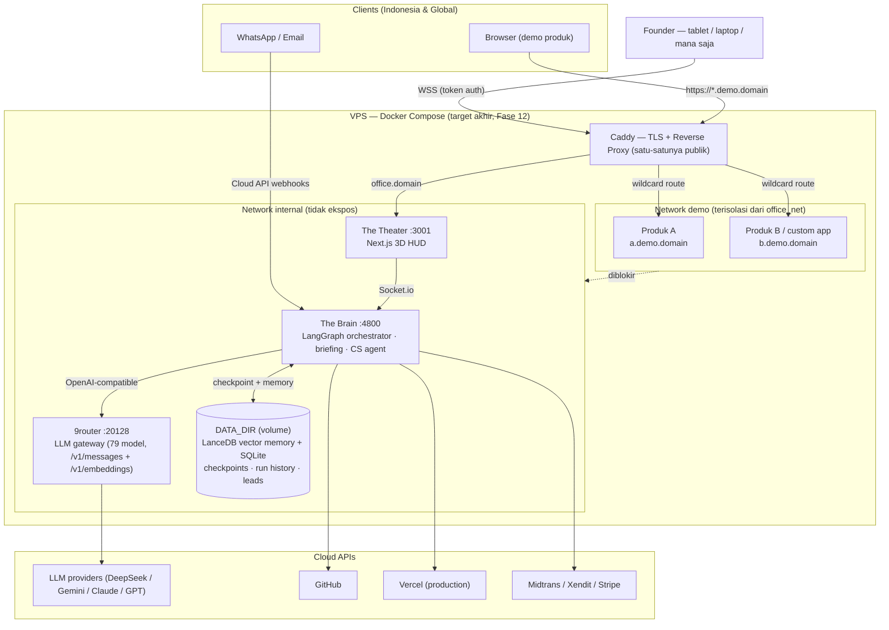
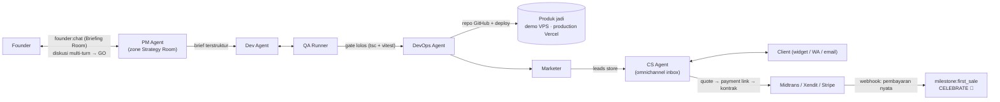
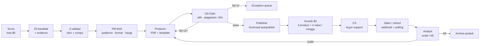

# 📑 MASTER PRODUCT REQUIREMENT DOCUMENT (PRD) & TECHNICAL BRIEF
**Project Name:** AutoOffice3D — Autonomous 3D AI Virtual Office (The Theater & The Brain)  
**Document Version:** 3.0 (Company Edition — Durability, Commerce & CS Loop)  
**Author:** AI Systems Architect & Product Team  
**Status:** Approved for Implementation  
**Addendum:** Venture Factory (Fase 14–18) — lane produk digital 100% otomatis untuk market US

**Execution Paradigm:** 100% Unattended Autonomous Execution (Zero-Human-in-the-Loop post Founder Prompt — termasuk fase *Briefing* diskusi PM sebelum run dimulai)

---

## 1. Executive Summary & Vision

### 1.1 Product Vision
**AutoOffice3D** adalah *kantor virtual pribadi* milik Founder: satu perusahaan software solution yang beroperasi **full-agent**. AutoOffice3D itu sendiri **bukan produk yang dijual** — melainkan mesin inkubasi: ide Founder dinegosiasikan dengan PM, di-build oleh Dev/QA/DevOps, dipasarkan oleh Marketer, lalu ditutup penjualannya oleh CS Agent. Yang dijual adalah **portofolio produk hasil generate** (landing page, micro-SaaS, custom app) kepada client nyata.

Kantor ini hidup **24/7 di VPS** (Docker), diakses Founder dari tablet/laptop kapan saja; demo produk ke client dijalankan per-instance di subdomain wildcard, dan deal ditutup dengan payment link + kontrak yang diterbitkan CS Agent.

Sejak **Fase 14**, kantor juga menjalankan **Venture Factory**: lane kedua yang tidak menunggu brief software dari Founder. Scout meriset tren market US secara mandiri, PM menilai portofolio kandidat, Producer membuat produk digital (toolkit PDF + template/checklist, ebook, template pack), QA memberi gate otomatis, Publisher mem-publish ke **Gumroad**, lalu Growth + CS menjual dan merawat pembeli. Lane ini berjalan **$0 sebelum ada sales**, tanpa approval manusia, dan hanya berhenti jika kena kill switch, policy gate, atau keputusan portofolio Analyst.

Seluruh dinamika dan komunikasi antar-agen tersebut direfleksikan secara instan dan *real-time* ke dalam antarmuka 3D isometrik web (*The Theater*) bergaya modern low-poly.

### 1.2 Business Operating Model
```
LANE SOFTWARE (brief Founder)
IDE (Founder) → BRIEFING (diskusi PM, multi-turn) → APPROVE ("GO") → BUILD otonom (PM→Dev→QA→DevOps)
      → MARKETING (Marketer → leads) → SALES (CS Agent: tanya jawab, follow-up, quote)
      → COMMERCE (payment link Midtrans/Stripe + kontrak PDF) → DEAL → PRODUCTION (Vercel/live)

LANE VENTURE (otonom penuh, Fase 14–18)
SCOUT (riset US $0) → PM/ANALYST (20 kandidat → 3 validasi) → PRODUCER (toolkit/ebook)
      → QA GATE (≥85, plagiarism <5%, policy 0) → PUBLISHER (Gumroad autopublish)
      → GROWTH (Threads/Bluesky/Pinterest/Reddit, X manual) → CS (buyer support)
      → SALES/REFUND (Gumroad webhook + polling) → ANALYST (scale/kill portfolio)
```
* **Diskusi dulu, otonom kemudian:** fase briefing adalah bagian dari "Founder Prompt" — begitu tombol GO ditekan, eksekusi kembali 100% tanpa intervensi.
* **Leads pipeline:** Marketer menaruh leads ke store bersama; CS Agent mengeksekusi (jawab, follow-up terjadwal, quote) hingga deal.
* **Multi-gateway:** market Indonesia → Midtrans/Xendit (QRIS, VA, e-wallet); market internasional → Stripe.

### 1.3 Target Milestones & Success Criteria (Definition of Done)
1. **Zero-Touch Delivery:** Dari 1 instruksi teks Founder hingga aplikasi online dengan URL Vercel aktif tanpa tombol persetujuan manusia manual.
2. **Deterministic QA Loop:** Dev dan QA agen beriterasi memperbaiki *type error* & unit test hingga skor kelulusan 100% dengan perlindungan *Circuit Breaker*.
3. **Persistent Memory Recall:** Agen berhasil menyimpan sintesis kerja ke Vector DB dengan cosine similarity > 0.85 untuk penggunaan siklus berikutnya.
4. **Interactive 3D Telemetry Synchronization:** R3F/Three.js frontend mencerminkan status koordinat, animasi berjalan, mengetik, dan selebrasi dengan latensi soket < 50ms.
5. **Monetization Event Loop:** Penangkapan webhook pembayaran (`checkout.session.completed` / notifikasi Midtrans) yang secara otomatis memicu mode selebrasi global (*Celebration State*).
6. **Restart-Safe Office:** Seluruh memory RAG, checkpoint graph, dan riwayat run **durable di disk** (`DATA_DIR`) — restart container/VPS = kantor *resume*, bukan reset.
7. **Briefing Before Autonomy:** Founder dapat berdiskusi multi-turn dengan PM (Briefing Room) sebelum run otonom dimulai; hasil diskusi terkompilasi jadi brief terstruktur.
8. **Real Commerce Close:** CS Agent menerbitkan payment link (Midtrans Snap / Stripe) + kontrak PDF dari deal hasil percakapan client — milestone first-sale dapat dipicu oleh pembayaran **nyata**, bukan simulasi.
9. **Venture Zero-Touch:** Scout→Producer→QA→Publisher menghasilkan produk digital yang lolos gate otomatis dan **live di Gumroad tanpa approval manusia**; target first sale tanpa biaya akuisisi berbayar.
10. **Portfolio Loop:** Analyst mengukur revenue bersih, refund, dan konversi per produk; portofolio 20 kandidat → 3 validasi → 1–2 produksi/bulan, dengan kill/scale otomatis dan auto-unpublish saat refund melewati batas.

---

## 2. System Architecture & Topology

Sistem dibagi secara tegas menjadi dua repositori independen (*Decoupled Non-Monorepo*) untuk memisahkan beban komputasi AI dengan performa rendering grafis 60 FPS:

```
┌────────────────────────────────────────────────────────┐
│               THE BRAIN (Backend Daemon)               │
│  LangGraph.js Orchestrator + Isolated Sandbox (E2B)    │
│  Vector Memory (LanceDB embedded · Pinecone optional)  │
│  Durable State: DATA_DIR (SQLite checkpoints + runs)   │
└──────────────────────────┬─────────────────────────────┘
                           │ Socket.io Event Stream
                           │ (Telemetry & State Diffs)
┌──────────────────────────▼─────────────────────────────┐
│              THE THEATER (Frontend Web HUD)            │
│  Next.js + React Three Fiber + Tailwind CSS            │
│  Low-Poly 3D Office + Briefing Room + Run History      │
└────────────────────────────────────────────────────────┘
```

### 2.1 Backend Repository: `brain/`
* **Framework:** Node.js (TypeScript) + LangGraph.js State Machine.
* **LLM Engine (Driver Pattern):** `createLLM` memilih driver via env `LLM_DRIVER=stub|anthropic|openai-compat` (auto → Anthropic → OpenAI-compatible bila key tersedia, fallback stub). Base URL dapat di-override (`ANTHROPIC_BASE_URL`/`OPENAI_COMPAT_BASE_URL`) sehingga kompatibel dengan gateway lokal **9router** maupun API resmi. Strategi model berjenjang (tier): model gratis/termurah didahulukan (benchmark menentukan pemenang, lihat §7 Fase 7). Task `code` memakai JSON mode + retry output; model reasoning yang menghabiskan budget untuk reasoning tidak dipakai untuk codegen.
* **Embeddings:** OpenAI `text-embedding-3-small` (driver `OPENAI_*`) dengan fallback `HashEmbedder` deterministik untuk mode offline/stub.
* **Code Sandbox:** E2B / Fly Machines isolated micro-VMs (menjalankan `npm install`, compile, Vitest headless) dengan timeout 60s.
* **Vector Memory (Driver Pattern):** driver `lancedb` (**default — embedded, durable, zero-server**) atau `pinecone` (cloud, opsional). Partisi namespace:
  * `pm-memory`: Standar PRD, user persona, benchmarking.
  * `dev-memory`: Template arsitektur kode, boilerplate Next.js/Stripe.
  * `qa-memory`: Edge-case test cases, anti-patterns.
  * `marketing-mem`: Formula copywriting viral, metrik engagement.
  * `briefing`: Histori diskusi Founder↔PM & percakapan client↔CS (Fase 8/11).
  * `venture-memory`: Riset market, kandidat, komparasi harga, QA feedback, dan keputusan scale/kill (Fase 14–18).
* **Durability Contract (`DATA_DIR`):** seluruh state durable berada di satu folder (default `brain/data/`): SQLite (checkpoint LangGraph via `@langgraph/checkpoint-sqlite`, riwayat run, event log) + folder LanceDB. Saat pindah VPS, folder ini di-*mount* menjadi Docker volume — restart = resume, bukan reset.
* **Realtime Protocol:** Socket.io Server (WebSockets + polling fallback) dengan enkripsi WSS.
* **Cloud API Integrations:** GitHub REST API v3, Vercel Edge API, Payment Gateway (Stripe/Midtrans/Xendit), WhatsApp Cloud API, email (Resend outbound + inbound adapter), X/Twitter API v2 (manual sampai first sale). Lane Venture menambah **Gumroad API v2** dan sumber riset gratis (Google Trends RSS, Reddit, YouTube Data API, Etsy, Product Hunt, Google Books, Bluesky public search).

### 2.2 Frontend Repository: `theater/`
* **Framework:** React 18+ (Next.js App Router) + TypeScript.
* **3D Viewport:** React Three Fiber (R3F) / Three.js r128+ + `@react-three/drei`.
* **State Management:** Zustand (Sinkronisasi store real-time dari Socket.io payload).
* **Styling & Design System:** Tailwind CSS v3, Plus Jakarta Sans, Palet Dark HUD `#051424`.
* **Audio FX:** Web Audio API (Ambient typing, hum server, fanfare chime saat transaksi pertama).

### 2.3 Deployment Topology & Target Environment
Periode pengembangan berjalan **lokal di mesin Founder** (Brain `:4800`, Theater `:3001`) — setiap fase wajib lolos soak test lokal beberapa minggu sebelum migrasi. Target akhir: **satu VPS menjalankan seluruh kantor via Docker Compose**:

* **Network internal** (`brain`, `theater`, `9router`) — tidak diekspos langsung ke publik.
* **Caddy** sebagai satu-satunya entry publik: TLS otomatis, `office.<domain>` → Theater (dilindungi token auth), `*.demo.<domain>` → container produk hasil generate (wildcard Let's Encrypt).
* **Network demo terisolasi** — container client tidak boleh dapat menjangkau Brain dari dalam jaringan Docker (*blast-radius* maksimal per produk).
* **9router** dijalankan via image resmi `decolua/9router` sebagai LLM gateway (opsional; fallback = API key langsung).



Catatan pemisahan tanggung jawab deployment: **VPS/Docker = demo & staging** produk hasil generate (murah, bisa di-spin up/down), **Vercel = production** setelah client deal (via integrasi DevOps yang sudah ada).

---

## 3. Multi-Agent State Machine & Division Specifications

Alur kerja backend diatur oleh Graf Siklus LangGraph dengan 5 divisi otonom. *Orchestrator* = runner graf LangGraph (thread checkpointed & resume-able), PM sebagai muka diskusi Founder:



### 3.1 Division 1: Product Management (PM Agent)
* **Briefing Phase (Fase 8 — diskusi dulu, otonom kemudian):** sebelum run dimulai, Founder dapat berdiskusi multi-turn dengan PM lewat event `founder:chat` (floating chat PM di Office Theater). PM mengajukan pertanyaan klarifikasi, menawarkan alternatif arsitektur/bisnis, dan merecall memori run sebelumnya (namespace `briefing` + `pm-memory`). Percakapan disimpan durable. Tombol **GO** di composer mengompilasi hasil diskusi menjadi brief terstruktur (`founder:directive` + konteks briefing) → graf otonom berjalan tanpa intervensi lanjutan. Chat PM adalah satu-satunya input manusia (Founder Command Bar lama dihapus agar tidak dobel).
* **Trigger Input:** Founder raw string (misal: *"Micro-SaaS invoice generator with Stripe integration"*) atau brief hasil briefing.
* **RAG Retrieval:** Query ke namespace `pm-memory` untuk mengambil pola arsitektur serupa.
* **Preset Selection:** PM memilih *project preset* produk — `landing` | `saas-fullstack` | `custom-app` (tier-1 TypeScript/Node; gate & Docker template mengikuti preset).
* **Output Artifact:** Berkas `specs/PRD-AutoInvoice.md` berformat markdown berisi:
  * Executive Summary & Target Audience
  * Functional User Stories (US-801, US-802, etc.)
  * TypeScript Data Contract / Interface definitions
  * Acceptance Criteria (AC).

### 3.2 Division 2: Full-Stack Engineering & QA Loop
* **Engineering Dev Agent:**
  * Membaca `PRD-AutoInvoice.md`.
  * Menghasilkan struktur berkas proyek (`src/routes`, `src/components`, `src/lib/stripe.ts`).
  * Mengirimkan diff kode ke sandbox runner.
* **QA Test Runner Agent:**
  * Mengeksekusi `vitest run --coverage` di dalam sandbox.
  * Memeriksa type-safety TypeScript (`tsc --noEmit`).
  * Jika terjadi kegagalan (test failed / compile error): Log error dikembalikan ke Dev Agent dengan counter iterasi bertambah (`Cycle N/5`).
* **Circuit Breaker Guardrail:**
  * Batas iterasi maksimal: **5 siklus**.
  * Jika siklus ke-5 masih gagal, sistem memotong eksekusi dan mengaktifkan fallback safe-build untuk mencegah pemborosan token (*token bleed*).

### 3.3 Division 3: DevOps & Autonomous Deployment
* **GitHub Repository Provisioning:** Membuat repositori publik baru secara terprogram via API (`POST /user/repos`), commit kode, dan push ke branch `main`.
* **Demo Deployment — `DEPLOY_DRIVER=docker` (Fase 10):** mem-*build* Dockerfile dari bundle hasil codegen (preset `landing`/`saas-fullstack`/`custom-app`), menjalankan container di network demo VPS, dan mendaftarkan subdomain `produk.demo.<domain>` ke Caddy. Instance demo dapat di-spin up/down (TTL/resource saving). Berlaku lokal terlebih dahulu (Docker Desktop) sebelum VPS.
* **Vercel Edge Deployment (Production):** Memicu deployment via Vercel API hook, memantau build status (`READY`), dan mengekstrak `live_url` (contoh: `invoiceai-gen.vercel.app`). Dipakai ketika client deal (promosi demo → production).
* **Health Check Probe:** Memverifikasi HTTP status 200 OK pada endpoint root dan endpoint API sebelum menandai deployment sukses.

### 3.4 Division 4: Growth, Marketing & Revenue Sentinel
* **Social Campaign Dispatcher:**
  * Menyusun posting pengumuman peluncuran produk dan hook *Build-in-Public*.
  * Mengirimkan thread ke Twitter/X API dan Meta Threads.
* **Leads Handoff:** setiap interaksi/peminat yang terdeteksi ditulis ke *leads store* bersama (SQLite + namespace vector `leads`) dengan skema `Lead { id, source, contact, interest, status: new|contacted|qualified|deal|lost, next_followup_at }` — siap dieksekusi CS Agent (§3.5).
* **Payment Sentinel (Multi-Provider):**
  * `PAYMENT_DRIVER=stub|stripe|midtrans|xendit` — abstraksi `PaymentProvider` dengan verifikasi signature webhook masing-masing (Stripe: HMAC-SHA256; Midtrans: SHA-512 `order_id+status_code+gross_amount+serverKey`) dan normalisasi ke payload `first_sale` yang sama. **Status Fase 9:** driver `stub|stripe|midtrans` aktif (`brain/src/payments/`), `xendit` masih kerangka interface; webhook masuk lewat `POST /webhook/<driver>` dengan status `200/400/401/501`; demo tanpa akun memakai driver `stub` (`/demo/checkout` + `/demo/pay`).
  * Memantau metrik pengunjung aktif dan konversi keranjang.
  * Begitu terdeteksi transaksi pertama ($29.00 ARR atau nominal IDR setara):
    1. Mengubah state global `hasCustomers = true`.
    2. Menyiarkan event `CELEBRATE` ke Socket.io.
    3. Mengirimkan email konfirmasi selamat datang otomatis ke pembeli.

### 3.5 Division 5: Customer Success (CS Agent)
* **Omnichannel Inbox (Fase 11):** adapter per channel menormalkan pesan masuk menjadi satu format event:
  * **Web widget** — client yang sedang mencoba produk demo mengobrol langsung dari halaman demo (via socket).
  * **WhatsApp Business (Cloud API)** — webhook pesan masuk; *constraint*: pesan outbound di luar jendela 24 jam sejak balasan terakhir wajib berupa template HSM yang disetujui Meta.
  * **Email** — adapter inbound terpisah (Mailgun/Postmark inbound webhook atau poller IMAP; Resend untuk outbound).
* **Follow-Up Engine (mini-CRM):** scheduler Brain menyapu leads dengan `next_followup_at` terlewat → CS Agent menyiapkan/mengirim pesan tindak lanjut (template WA / email) sesuai status lead.
* **Closing Flow:** saat client deal → CS menerbitkan **payment link** (Midtrans Snap / Stripe Payment Link — halaman bayar hosted, tanpa form kartu sendiri) + **kontrak PDF** dari template (data client/produk/harga terisi otomatis) → dikirim via channel yang sama.
* **Memory & Handshake:** percakapan client disimpan di namespace `briefing`; ringkasan deal di-upsert ke `pm-memory` sehingga run berikutnya tahu konteks client.

### 3.6 Division 6: Venture Factory (Fase 14–18)
* **Misi:** menjalankan lane produk digital otonom untuk market US — riset tren tanpa niche awal, validasi portofolio, produksi toolkit/ebook, QA gate, autopublish Gumroad, distribusi organik $0, buyer support, dan analisis scale/kill.
* **Pemisahan lane:** lane software (`runAutonomous`: PM→Dev→QA→DevOps) **tidak diubah**. Venture memakai orchestration/checkpoint/tabel/event sendiri (`venture_runs`/`ventures`/`venture_events`) agar kegagalan produk digital tidak merusak pipeline software dan sebaliknya.
* **Agent & zona:**
  * **Scout** — riset pasar US, kumpulkan kandidat + evidence; MVP di Strategy Room (`meeting_room`), Fase 18 pindah ke Venture Lab.
  * **Producer** — outline → draft → PDF toolkit + template/checklist + cover; MVP di Creative Studio (`marketing_studio`).
  * **Publisher** — create product, upload file/cover, enable, offer code, sales/refund sync ke Gumroad; MVP di Creative Studio.
  * **Analyst** — metrik portofolio, scale/kill (Fase 18; sebelum itu PM merangkap).
  * **Reuse:** PM (judge/brief), QA (content gate), DevOps (landing Vercel), Growth (distribusi), CS (buyer support), Founder (budget/kill switch).
* **Alur:**

* **Prinsip keras:** (1) **zero-budget** sebelum first sale — tidak ada API/iklan berbayar; (2) **autopublish tanpa approval manusia**, tetapi hanya setelah QA gate otomatis lolos; (3) **evidence URL wajib** untuk setiap klaim riset; (4) **produk asli** — plagiarism <5%, tanpa aset berhak cipta; (5) **kill cepat** — portofolio 20→3→1–2 produk/bulan; (6) **refund >8% setelah ≥10 sales** → auto-unpublish.
* **UI:** satu kartu **“Venture Lab”** di sidebar → route `/studio` (bukan overlay fixed). Zone 06 + avatar CS baru dibuat di Fase 18; MVP memakai zona existing.
* **Spesifikasi operasional lengkap:** §9.

---

## 4. 3D Virtual Theater Technical Specifications

### 4.1 Zone Coordinates Matrix (The Map)
Ruang kantor dimodelkan dalam sistem grid isometrik 3D berukuran 60x60 unit dengan origin (0,0,0) di pusat Neural Bus:

| Zona ID | Nama Zona | Koordinat (X, Y, Z) | Dimensi (W x D) | Aksen Warna | Divisi Penghuni |
| :--- | :--- | :---: | :---: | :---: | :--- |
| `zone_01` | Founder Desk | `(-14, 0.4, 14)` | 10 x 10 | `#6366f1` (Indigo) | Founder Avatar |
| `zone_02` | Strategy / Meeting Room | `(-13, 0.4, -13)` | 12 x 11 | `#f59e0b` (Amber) | PM Agent & Brainstorming |
| `zone_03` | Core Dev & QA Lab | `(14, 0.4, -12)` | 14 x 12 | `#10b981` (Emerald) | Dev Agent & QA Runner |
| `zone_04` | Creative & Marketing Studio | `(14, 0.4, 12)` | 12 x 11 | `#ec4899` (Pink) | Growth & Social Agent |
| `zone_05` | DevOps & Cloud Hub | `(0, 0.4, 16)` | 8 x 8 | `#06b6d4` (Cyan) | Infra & Server Racks |
| `zone_06` | Venture Lab *(Fase 18)* | `(-14, 0.4, -2)` | 10 x 8 | `#a855f7` (Purple) | Scout, Producer, Publisher, Analyst, CS Avatar |
| `hub_00` | Central Neural Bus | `(0, 0.4, 0)` | 8 x 8 | `#38bdf8` (Sky) | Hologram Router |

### 4.2 Low-Poly Bipedal Character Rigs & Animation States
Karakter agen dibangun dengan geometri modular low-poly (*box-man*), terdiri dari:
* **Body:** Kubus torso dengan rompi warna divisi.
* **Glowing Head:** Kubus kepala ber-emissive shader yang intensitas pendarannya meningkat saat berpikir/mengetik.
* **Limbs:** Lengan dan kaki dengan pivot sendi untuk siklus berjalan (*walking cycle*) dan mengetik (*working cycle*).
* **Floating Speech Bubble:** Overlay 2D/3D billboard di atas kepala agen yang menampilkan log aksi langsung.

#### State Matrix:
1. `IDLE`: Agen duduk di kursi meja masing-masing dengan osilasi pernapasan halus (*subtle sine wave* Y: ±0.03).
2. `WORKING`: Tangan agen mengayun mengetik pada keyboard meja, emisi kepala berdenyut dengan frekuensi 8Hz.
3. `WALKING`: Interpolasi posisi linier (Lerp) dari koordinat asal ke target waypoint dengan ayunan kaki berlawanan arah (*stride swing*).
4. `CELEBRATE`: Dipicu saat `hasCustomers = true`. Semua agen berkumpul di Central Hub, melompat berulang kali (Y: +1.4), dan memancarkan partikel konfeti.

### 4.3 Camera Viewport & Controls
* **Default Isometric Angle:** `Position(38, 30, 42)`, `LookAt(0, 0, 0)`, FOV 40°.
* **Orbit Controls:** Smooth damping rotation dengan batasan polar angle (0.2 hingga π/2.2).
* **Cinematic Presets:**
  * `Overview`: Tampilan menyeluruh 5 zona kantor.
  * `Founder`: Kamera fokus ke Meja Founder saat pengetikan prompt awal.
  * `Dev Lab`: Kamera zoom ke meja Dev & QA saat iterasi build berlangsung.
  * `Meeting`: Kamera fokus ke Meja Bundar saat fase diskusi PM.
  * `Venture` *(Fase 18)*: Kamera fokus ke Venture Lab saat riset/produksi/publish produk digital.

### 4.4 HUD Components & Views (v3.0)
* **Floating PM Chat (Fase 8; menggantikan tab Briefing Room & Founder Command Bar):** dock kiri-bawah di Office Theater — thread percakapan (avatar PM), composer dua baris + tombol **"GO — mulai run otonom"**, bisa diciutkan jadi pill/FAB. HUD dev (perf) dan tombol demo Celebrate dipindah ke bar tab agar tidak menutupi canvas/chat/stream. Berbagi infra percakapan dengan CS Inbox.
* **Briefing Room (Fase 8):** floating chat PM (dock kiri-bawah di Office Theater, bisa diciutkan) untuk diskusi multi-turn; tombol **"GO — mulai run otonom"** di composer. Tidak ada tab terpisah; route lama `/briefing` redirect ke office. Berbagi infra percakapan dengan CS Inbox.
* **Run History (Fase 7):** tab/panel riwayat run dari SQLite — bertahan setelah restart browser maupun server.
* **CS Inbox (Fase 11):** daftar percakapan client per channel (widget/WA/email) + status lead + aksi cepat (quote, payment link, kirim kontrak).
* **Venture Lab (Fase 14–18):** satu kartu sidebar → `/studio`; board kandidat + evidence, produk + QA score/plagiarism, listing Gumroad, sales/refund, exception queue, dan portfolio scale/kill. Tidak menambah overlay fixed; detail berat ada di route `/studio`.

---

## 5. Real-Time Telemetry Protocol (Socket.io Schema)

### 5.1 Event: `agent:status_update`
Dikirimkan dari backend setiap kali agen berpindah state atau menghasilkan progres baru:

```typescript
interface AgentStatusPayload {
  runId: string;
  agentId: 'founder_agent' | 'pm_agent' | 'dev_agent' | 'qa_agent' | 'devops_agent' | 'marketing_agent';
  division: 'Product' | 'Engineering' | 'QA' | 'DevOps' | 'Growth';
  currentAction: 'idle' | 'walking' | 'discussing' | 'coding' | 'testing' | 'deploying' | 'marketing' | 'celebrating';
  targetZone: 'founder_desk' | 'meeting_room' | 'dev_lab' | 'marketing_studio' | 'devops_hub' | 'central_bus';
  coordinates?: { x: number; y: number; z: number };
  logMessage: string;
  iterationCycle?: { current: number; max: number };
  telemetry: {
    tokensUsed: number;
    latencyMs: number;
    model: string;
  };
  timestamp: string;
}
```

### 5.2 Event: `milestone:first_sale`
Memicu selebrasi kantor global:

```typescript
interface FirstSalePayload {
  runId: string;
  customer: {
    city: string;
    country: string;
    maskedEmail: string;
  };
  amount: number; // e.g. 29.00
  currency: 'USD' | 'IDR';
  paymentProvider: 'stripe' | 'midtrans' | 'xendit' | 'stub';
  paymentEventId: string;
  hasCustomers: true;
  timestamp: string;
}
```

### 5.3 Event: `founder:chat` / `pm:reply` (Fase 8)
Kanal percakapan multi-turn Founder↔PM (dan CS↔client dengan namespace chat sama):

```typescript
interface ChatTurnPayload {
  conversationId: string;
  channel: 'briefing' | 'cs_widget' | 'cs_whatsapp' | 'cs_email';
  role: 'human' | 'agent';
  agentId?: 'pm_agent' | 'cs_agent';
  message: string;
  citations?: string[]; // recall dari vector memory
  timestamp: string;
}
// Client → Server : founder:chat { conversationId, message }
// Server → Client : pm:reply   { ...ChatTurnPayload, role: 'agent', agentId: 'pm_agent' }
```

### 5.4 Event: `payment:link_created` (Fase 9/11)
Dipublikasikan ketika CS Agent menerbitkan payment link untuk sebuah deal:

```typescript
interface PaymentLinkPayload {
  leadId: string;
  provider: 'stripe' | 'midtrans' | 'xendit' | 'stub';
  checkoutUrl: string;      // hosted payment page (Snap / Payment Link)
  amount: number;
  currency: 'USD' | 'IDR';
  contractUrl?: string;     // URL kontrak PDF hasil generate
  expiresAt?: string;
  timestamp: string;
}
```

### 5.5 Event: `venture:*` (Fase 14–18)
Kontrak lane Venture **terpisah** dari `agent:status_update` software, tetapi tetap divalidasi Zod di brain dan diduplikasi terkontrol di theater (`brain/src/server/contract.ts` ↔ `theater/lib/events.ts`). Semua payload membawa `runId` venture dan `ventureId`.

```typescript
type VentureStage =
  | 'discover' | 'validate' | 'produce' | 'qa' | 'publish'
  | 'market' | 'sell' | 'analyze' | 'scale' | 'kill' | 'exception';

type VentureAgentId =
  | 'scout_agent' | 'producer_agent' | 'publisher_agent' | 'analyst_agent';

interface VentureStatusPayload {
  runId: string;
  ventureId: string;
  stage: VentureStage;
  agentId: VentureAgentId;
  message: string;
  candidateId?: string;
  productId?: string;
  timestamp: string;
}

interface VentureCandidatePayload {
  runId: string;
  ventureId: string;
  candidateId: string;
  title: string;
  niche: string;
  score: number;              // 0–100
  evidenceUrls: string[];     // wajib, minimal 2 sumber independen
  status: 'new' | 'validated' | 'rejected';
  timestamp: string;
}

interface VentureProductPayload {
  runId: string;
  ventureId: string;
  productId: string;
  title: string;
  price: number;              // USD, guardrail $9–79
  currency: 'USD';
  qaScore: number;            // gate ≥85
  plagiarismPct: number;      // gate <5
  policyFlags: string[];      // gate = 0
  status: 'draft' | 'ready' | 'published' | 'paused' | 'killed';
  listingUrl?: string;
  timestamp: string;
}

interface VentureSalePayload {
  runId: string;
  ventureId: string;
  productId: string;
  saleId: string;             // Gumroad sale id — dedupe bersama resource_name
  resourceName: string;       // 'sale' | 'refund' | 'dispute'
  kind: 'sale' | 'refund' | 'dispute';
  amount: number;
  currency: 'USD';
  fee: number;
  net: number;
  refundRate?: number;
  timestamp: string;
}

interface VentureMetricsPayload {
  ventureId: string;
  productId: string;
  views: number;
  clicks: number;
  sales: number;
  refunds: number;
  gross: number;
  fees: number;
  net: number;
  conversion: number;         // 0–1
  timestamp: string;
}

interface VentureExceptionPayload {
  runId: string;
  ventureId: string;
  productId?: string;
  reason: string;
  score?: number;
  timestamp: string;
}
```

Event names: `venture:status`, `venture:candidate`, `venture:product`, `venture:sale`, `venture:metrics`, `venture:exception`. `venture:sale` mencakup sale/refund/dispute agar UI punya satu stream; detail dibedakan oleh `kind`.

---

## 6. Security, Sandboxing & Risk Mitigations

1. **Host Isolation:** Kode yang ditulis oleh Dev Agent tidak pernah dijalankan di OS mesin backend. Semua eksekusi `node`, `vitest`, dan `npm` wajib diisolasi di container E2B/gVisor sandboxed dengan akses jaringan terbatas.
2. **API Key Vault:** Kredensial Vercel, GitHub, Stripe, dan Twitter disimpan dalam vault memori terenkripsi AES-256 dan hanya diinjeksi ke instance runner per-tugas.
3. **Prompt Injection & Code Poisoning Guard:** Validasi sintaks AST statis terhadap kode sebelum pengujian untuk mencegah pembacaan file sistem lokal atau exfiltrasi env var host.
4. **Token Bleed Protection:** Batas pengeluaran token maksimum per run ditetapkan sebesar 250.000 tokens dengan hard-kill jika terlampaui.
5. **VPS Public Access Auth (Fase 12):** Theater di VPS wajib dilindungi token/basic auth + rate limit; Brain tidak diekspos langsung (hanya melalui jaringan Docker internal). Token budget guard tetap menjadi benteng terakhir biaya.
6. **Demo Network Isolation (Fase 10/12):** container produk demo berjalan di Docker network terpisah dan **diblokir menjangkau Brain/9router/DATA_DIR** — kompromi satu demo tidak membahayakan kantor.
7. **Venture IP & Copyright Guard (Fase 15):** Producer wajib menghasilkan konten orisinal; QA menghitung plagiarism <5% terhadap corpus riset + memeriksa aset (gambar/font/template) yang dipakai. Dilarang memakai trademark, logo, atau klaim “guaranteed income”. Lisensi produk wajib disertakan.
8. **Gumroad Webhook Untrusted (Fase 16):** webhook Gumroad **tidak bertanda tangan**. Payload mentah tidak boleh langsung dipercaya; brain wajib refetch sale/refund via API, dedupe `sale_id + resource_name`, dan menyimpan raw payload untuk audit.
9. **Zero-Budget Guard (Fase 14–17):** `VENTURE_ZERO_BUDGET=true` memblokir driver/API berbayar dan iklan. X/Twitter tidak diotomasi sampai first sale (API pay-per-use); Amazon dilarang (tanpa API gratis + scraping). Semua sumber riset wajib gratis dan di-cache.
10. **Account Isolation (Fase 14–18):** seluruh akun Gumroad, Threads/Meta, Bluesky, Pinterest, Reddit, YouTube, Telegram, email support, dan Vercel adalah **akun baru khusus project ini** — bukan akun lama Founder. Token disimpan di `.env`/vault, tidak pernah dikirim ke Theater, dan dirotasi bila bocor.

---

## 7. Delivery Roadmap & Checklist Implementasi

> Status per PRD v3.0: **Fase 1–13 selesai & merged** — Brain **413/413 test**, Theater **104/104 test**, `npm run verify` hijau, e2e smoke browser PASS (directive → briefing → GO → replay → CS closing widget → payment stub). Fase 13 (hardening & polish) menuntaskan driver LLM OpenAI-compatible, budget harian lintas-run + estimasi biaya, aksesibilitas/motion, bersih-bersih dead code + preset kamera, ADR + `bench/latest.md`, dan hardening HTTP (limit body, CORS allowlist). **Fase 12 menyisakan pekerjaan runtime**: soak ≥2 minggu, verifikasi Docker/9router, dan migrasi VPS — butuh waktu/VPS/kredensial, bukan kode. Seluruh fase berlangsung **lokal di mesin Founder** terlebih dahulu; soak test beberapa minggu menjadi prasyarat migrasi VPS (Fase 12).
>
> **Fase 14–18 (Venture Factory) berstatus 📋 Planned.** Urutan build: kapabilitas riset & data durable dulu (14), produksi + QA gate (15), autopublish Gumroad + uang masuk (16), distribusi $0 + CS (17), lalu analyst/portofolio + Zone 06 + avatar CS (18). Tidak ada fase venture yang boleh mem-publish sebelum gate QA otomatis di Fase 15 hijau.

| Fase | Status | Deliverable Utama |
| :--- | :---: | :--- |
| **Fase 1: State Machine & Backend Daemon** | ✅ Selesai | • LangGraph.js graph & router divisi<br>• Memory driver (stub, offline-first)<br>• Sandbox runner deterministik |
| **Fase 2: 3D Isometric Viewport & Scene** | ✅ Selesai | • Geometri kantor & zona koordinat<br>• Karakter low-poly bipedal & state animasi<br>• Kamera orbit & preset |
| **Fase 3: Socket.io Real-Time Synchronization** | ✅ Selesai | • Pipeline event stream ke store frontend<br>• Sinkronisasi speech bubble & koordinat agen |
| **Fase 4: External Integrations & Revenue Loop** | ✅ Selesai | • GitHub + Vercel auto-deploy<br>• Stripe webhook sentinel (simulasi $29 ARR) |
| **Fase 5: Polish & End-to-End Testing** | ✅ Selesai | • Run end-to-end otonom penuh<br>• Optimasi render & stabilitas |
| **Fase 6: Founder Command Bar** | ✅ Selesai (kemudian digantikan floating PM chat) | • Input manusia tunggal di semua tab<br>• `founder:directive` + ack + riwayat prompt |
| **Fase 7: Durability + Evaluasi Model** | ✅ Selesai | • `DATA_DIR` contract; LanceDB driver (vector memory durable); SQLite checkpoint (`@langgraph/checkpoint-sqlite`) + resume run terputus; run-history & event log<br>• Unit test `AnthropicLLM` (mock fetch); wiring `ANTHROPIC_BASE_URL`/`OPENAI_BASE_URL`; `.env.example`<br>• Script benchmark `bench-llm.mjs`: N run/model → % lolos gate tsc+vitest, latensi, token — tier 0 (free) → tier 1 murah (DeepSeek 4.1 Flash duluan) → tier 2/3 hanya jika < 80% lolos |
| **Fase 8: Briefing Room** | ✅ Selesai | • Event `founder:chat` → `pm:reply` sesuai kontrak `ChatTurnPayload` (PRD §5.3) + `briefing:history`; ack konsisten dengan `founder:directive`<br>• Namespace vector `briefing` durable (LanceDB) + API `list` kronologis (`seq`) — percakapan selamat restart<br>• PM Briefing Agent: LLM task `briefing` (recall `briefing`+`pm-memory` → citations) & task `brief` (compile brief terstruktur: audience/fitur/preset/harga, heuristik deterministik saat stub/non-JSON)<br>• UI tab Briefing Room: bubble thread + avatar PM + typing indicator + tombol GO (disabled saat thread kosong) → compile brief → `founder:directive` (+brief masuk `pm-memory`) → run otonom penuh; Command bar tetap fast-path<br>• Test: unit chat flow + integrasi socket E2E (diskusi → GO → milestone) + smoke browser diperluas |
| **Fase 9: Payment Abstraction** | ✅ Selesai | • `PaymentProvider` interface (`createPaymentLink`, `receiveWebhook` → `FirstSalePayload`) + factory `createPayment` (pola `createLLM`); driver **stub** (demo lokal), **stripe** (HMAC-SHA256 + Payment Links), **midtrans** (Snap hosted + notifikasi SHA-512 + tolerance replay), **xendit** (kerangka interface, isi di Fase 11) — `PAYMENT_DRIVER=auto\|stub\|stripe\|midtrans\|xendit` fail-fast tanpa kredensial<br>• Kontrak §5.2 diperbarui: `FirstSalePayload.paymentProvider` + `paymentEventId` (menggantikan `stripeEventId`), `currency USD\|IDR`, field `currency` di `revenue:update`; idempotensi lintas provider per event id<br>• Webhook per driver `POST /webhook/<driver>` (200/400/401/501) + demo stub `GET /demo/checkout` → `POST /demo/pay` (simulasi bayar → `milestone:first_sale`); event socket `payment:simulate` menggantikan `stripe:simulate`<br>• Pecah `server/socket.ts` → `server/http.ts` (health/control/webhook/demo) + `server/socket.ts` (bootstrap + io handlers); `/health` diperkaya status payment sentinel<br>• Test: stripe dimigrasi + midtrans (signature/mapping/tolerance/Snap) + stub demo + factory; e2e smoke browser diperluas (Simulate Payment → milestone + CELEBRATE) |
| **Fase 10: Demo Harness** | ✅ Selesai* | • Preset stack tier-1 `brain/src/products/presets/`: `landing` (port 4173) / `saas-fullstack` (3000, Dockerfile multi-stage npm) / `custom-app` (8080) — masing-masing punya Dockerfile template + gate sendiri (`RUN node selftest.mjs`, dijalankan saat image build); PM memilih preset dari brief (`Preset stack:` eksplisit → keyword → default `saas-fullstack`) → `state.preset`<br>• `DEPLOY_DRIVER=docker` (`brain/src/integrations/dockerdeploy.ts`): render stack + tulis build context (bundel codegen terisolasi di `codegen/` + `provenance.json`) → `docker build` → `docker run` di network `demo-net` (tanpa volume; `--add-host=host.docker.internal:0.0.0.0`; cap-drop; memory/cpu limit; label `autooffice3d.*` siap Caddy Fase 12) → health probe `/health` HTTP 200 sebelum status READY; spin up/down (`spinDown` = `docker rm -f`); degradasi rapi bila daemon mati (`degradedReason`); exec injectable → diuji tanpa daemon<br>• Routing subdomain lokal: mapping port host `4510–4599` (+ `DEPLOY_PUBLISH_HOST`/`DEPLOY_PROBE_HOST` untuk compose office stack); label `autooffice3d.route=demo.<slug>.localhost`<br>• Event replay: `run_events` (ascending) → socket `run:replay` (frame `start → event* → end`, ack `{total, stepMs}`, cancel per socket) → panel Theater "Run Replay · Event Log" (daftar run durable + progress + timeline, tombol ▶/⏹)<br>• `brain/Dockerfile` + `theater/Dockerfile` (standalone) + `docker-compose.yml` (brain/theater/Caddy, network `office`+`demo-net`) + `deploy/Caddyfile` (vhost office; wildcard demo disiapkan Fase 12); gate `npm run e2e:docker` (smoke 3 preset: akses produk + isolasi + spin down)<br>• Test: preset (gate via `node selftest`, heuristik preset) + DockerDeploy (fake exec, tanpa Docker) + replay socket & store; e2e smoke browser diperluas (observer replay + playback UI)<br>*Verifikasi smoke Docker Desktop lokal ditunda (ruang disk mesin Founder) — `npm run e2e:docker` siap dijalankan kapan pun / saat soak Fase 12 |
| **Fase 11: CS Agent** | ✅ Selesai | • Leads store durable SQLite (`leads` + `cs_messages`) + satu bentuk `NormalizedInbound` untuk 3 adapter: widget (disajikan Brain `/widget/*`, disisipkan ke halaman preset lewat `PresetRenderInput.widget`), WhatsApp Cloud API (verify + inbound `GET/POST /webhook/whatsapp`, guard 24 jam → template HSM `hello_world`), email inbound Mailgun/Postmark (`POST /webhook/email` + header `x-cs-inbound-secret`) — conversation id `cs:<source>:<contact>`<br>• CS Service: balasan LLM task `cs` (recall `briefing`+`leads`, citations), handoff Marketer deterministik (`lead_<runId>_<n>`, resume-safe), auto-quote saat niat beli (`harga\|price\|berapa\|biaya\|invoice\|bayar\|checkout\|beli\|deal\|langganan`) tanpa dobel kirim<br>• Closing flow: quote → payment link driver aktif → kontrak PDF 1 halaman (generator tanpa dependency, auto-scale agar semua klausa muat) → `payment:link_created`; settlement webhook (`outcome.leadId`) → `markDeal` + ringkasan `pm-memory` + status deal; download `GET /cs/contracts/<lead>.pdf`<br>• Follow-up engine: scheduler interval (`CS_FOLLOWUP_MS`, default 60s) + socket `cs:sweep {force}`; template deterministik per status (qualified menyertakan checkout+kontrak); 3× tanpa respons → lost; WA di luar jendela 24 jam otomatis template HSM<br>• Theater tab `/inbox`: daftar lead + transkrip durable, aksi quote/kontrak/checkout, sweep manual, badge status; event `lead:update`, `cs:message`, `payment:link_created` (skema Zod paritas + snapshot `leads` saat connect)<br>• Env baru di `brain/.env.example` (`WHATSAPP_*`, `EMAIL_INBOUND_SECRET`, `CS_*`); e2e smoke diperluas (widget → CS Inbox → quote → kontrak PDF → bayar → deal) |
| **Fase 12: Soak Test → Go-Live VPS** | 🚧 Infra siap · soak & VPS pending | ✅ Backup otomatis `DATA_DIR` (tar + checksum + retensi, uji restore RunStore)<br>✅ Logging pino (`LOG_LEVEL`) + `/health` diperkaya (uptime, driver, run, ukuran DATA_DIR)<br>✅ Notifikasi founder Telegram/Discord (stub default; sale/deploy/run gagal/breaker)<br>✅ Auth token socket/HTTP + compose lokal & overlay VPS (brain tanpa port publik, 9router internal, DATA_DIR volume, isolasi demo-net)<br>🕓 Soak test lokal ≥2 minggu (run stabil tanpa intervensi)<br>🕓 Verifikasi runtime Docker/9router headless + Caddy wildcard demo<br>🕓 Migrasi data → VPS + smoke test penuh dari tablet |
| **Fase 13: Hardening & Polish (pasca go-live)** | ✅ Selesai | • **LLM OpenAI-compatible** (`brain/src/llm/openai.ts`): `POST {base}/chat/completions` + env `OPENAI_COMPAT_API_KEY/BASE_URL/MODEL`; `LLM_DRIVER=openai-compat`; urutan `auto` = anthropic → openai-compat → stub; key terpisah dari `OPENAI_API_KEY` embeddings; timeout/retry sama dengan driver Anthropic (7 test + paritas)<br>• **Budget harian lintas-run** `DAILY_TOKEN_BUDGET` (default 2.000.000, 0 = nonaktif): run baru ditolak `DailyBudgetExceededError` (ack `ok:false`) sebelum efek samping; status di `/health`, `system:hello`, dan event baru `budget:update` (skema Zod paritas) → header Theater "Budget"; **estimasi biaya** via `brain/src/llm/pricing.ts` (tabel harga benchmark) memakai `TokenBudget.usage` input/output terpisah → CLI run + `artifacts:ready.costUsd`<br>• **Aksesibilitas/motion**: `theater/lib/motion.ts` (`prefers-reduced-motion` → konfeti dilewati, kamera snap tanpa lerp, `enableDamping=false`, blok CSS reduced-motion), popover riwayat directive `aria-expanded/aria-controls` + Escape + fokus pindah, banner milestone `role=status aria-live=polite`, navigasi keyboard tab sidebar (`nextTabIndex`) — helper `theater/lib/a11y.ts`<br>• **Bersih-bersih**: hapus `getBrainSocket`, `formatUsd`, `GUTTER_DESKTOP/MARGIN_DESKTOP`, `useMemoVec`; folder kosong `scene 2`; tick ZoneMatrix 6→1 interval agregat; preset kamera `meeting`/`devOps` kini terjangkau via `CameraPresets` (5 preset + orbit)<br>• **Dokumentasi**: `docs/ADR/0001–0009` (driver offline-first, DATA_DIR, kontrak duplikat, socket bridge, payment multi-provider, isolasi demo, auth token, backup/soak, openai-compat+budget) + `bench/latest.md` (baseline stub 3/3 + harga referensi; bench live pending token 9router)<br>• **Hardening HTTP**: limit body webhook `WEBHOOK_MAX_BODY_BYTES` (413, bukan crash) + CORS allowlist `CORS_ORIGINS` (HTTP preflight + socket.io); Next dipatch ke **14.2.35**; residual `npm audit` (Next 16/Tailwind 4/lancedb) didokumentasikan sebagai deferral upgrade major — lihat ADR/komentar kartu |
| **Fase 14: Venture Core + Riset $0** | 📋 Planned | • Lane Venture terpisah: `venture_runs`/`ventures`/`venture_candidates`/`venture_research`/`venture_products`/`venture_sales`/`venture_posts`/`venture_exceptions` + `venture_events`; state machine `discover→validate→produce→qa→publish→market→sell→analyze→scale/kill`<br>• Agent `scout_agent`/`producer_agent`/`publisher_agent` + kontrak `venture:*` (paritas brain/theater), zona MVP Strategy/Creative Studio, sidebar “Venture Lab” + `/studio`<br>• Research driver $0: Google Trends RSS US, Reddit, YouTube Data API, Etsy, Product Hunt, Google Books, Bluesky; cache 24 jam + evidence URL wajib; stub saat offline<br>• Scoring 20 kandidat → 3 validasi (demand, competition gap, WTP, effort, policy risk, distribution fit) → PM brief; zero-budget guard + kill switch |
| **Fase 15: Produksi Toolkit + QA Gate** | 📋 Planned | • Producer pipeline: brief → `toolkit.pdf` (target 15–30 halaman) + `assets.zip` (3 template/checklist) + cover + `metadata.json` + `license.txt`; render deterministik, English US<br>• QA rubric 100: content 30, accuracy/evidence 20, originality 20, policy 15, listing 15; gate **≥85**, plagiarism **<5%**, **0 policy flag**, harga **$9–79**, listing lengkap<br>• Revisi otomatis maks 2× → exception queue; artifact store durable + checksum + preview `/studio`; harga awal dari comps market (bukan range fixed Founder)<br>• E2E kandidat → produk → QA pass/fail, tanpa publish |
| **Fase 16: Gumroad Autopublish + Sales** | 📋 Planned | • Gumroad driver: `POST /v2/products`, presign→S3→complete→attach file, cover, `PUT /v2/products/:id/enable`, offer codes; token server-side + idempotency<br>• Autopublish hanya setelah QA pass; tanpa approval manusia; listing URL + event `venture:product`<br>• Webhook `sale/refund/dispute` **unsigned** → refetch via API + dedupe `sale_id + resource_name` + polling fallback; sales/refund metrics<br>• Auto-unpublish jika refund **>8% setelah ≥10 sales**; mock E2E publish→sale→refund + live canary checklist |
| **Fase 17: Growth $0 + CS** | 📋 Planned | • Adapter gratis: Threads (250 post/hari), Bluesky, Pinterest, Reddit (value-only), X manual sampai first sale; warm-up 7 hari<br>• Calendar **3 product post + 4 value post/minggu**, target 1 product post/hari, cap **3 post/hari**; varian per platform + UTM<br>• Gumroad Email/Workflows untuk receipt/follow-up (Resend ditunda sampai domain); email support + CS buyer support/refund<br>• Landing page per produk di Vercel free + SEO; UTM/funnel metrics; E2E publish→post→click→sale→CS |
| **Fase 18: Analyst/Portfolio + Zone 06 + Avatar CS** | 📋 Planned | • `analyst_agent` + portfolio metrics (revenue, fees, net, conversion, refund per produk/channel); weekly report + rekomendasi scale/kill<br>• Scale/kill rules (default kill <3 sales/30 hari, refund >8%/10 sales, net negatif; configurable) + cap **1–2 produk baru/bulan**; portofolio 20→3→1–2<br>• Zone 06 `venture_lab` + avatar Scout/Producer/Publisher/Analyst/CS + camera preset “Venture”; advanced `/studio` (research/production/QA/publishing/growth/portfolio/exceptions)<br>• Scheduler harian/mingguan + Telegram digest; final E2E, ADR/runbook, PRD/board sinkron |

---

## 8. Commerce Stack & Market Strategy

### 8.1 Software Lane — Midtrans / Stripe

| Aspek | Market Indonesia | Market Internasional |
| :--- | :--- | :--- |
| **Gateway** | **Midtrans** (GoTo) — QRIS, Virtual Account (BCA/BNI/BRI/Mandiri), e-wallet (GoPay/OVO/DANA/ShopeePay), kartu kredit, retail (Alfamart/Indomaret); alternatif **Xendit** (multi-negara, DX baik) | **Stripe** (driver yang sudah ada & teruji) |
| **Mekanisme penagihan** | CS Agent menerbitkan **Snap payment link** (hosted) | CS Agent menerbitkan **Stripe Payment Link** |
| **Webhook** | Signature SHA-512 `order_id+status_code+gross_amount+serverKey` | HMAC-SHA256 `Stripe-Signature` |
| **Kontrak** | PDF template (data deal terisi otomatis) dikirim via channel yang sama | idem |

*Catatan:* prasyarat onboarding gateway (badan usaha, KYC, pajak/PPN) wajib diverifikasi ulang sebelum mengaktifkan driver live (`PAYMENT_DRIVER=stripe|midtrans|xendit`) — arsitektur driver memastikan pergantian/penambahan gateway tidak menyentuh Theater & milestone. Abstraksi driver sudah terbukti pada Fase 9; kredensial live tinggal diisi di `.env`.

### 8.2 Digital Product Lane — Gumroad (Venture Factory)

| Aspek | Detail |
| :--- | :--- |
| **Market** | United States (English), harga USD; produk digital: toolkit PDF + template/checklist, ebook, template pack |
| **Checkout** | Gumroad hosted checkout — tidak ada form kartu sendiri; pembeli diarahkan ke listing Gumroad |
| **Fee** | Direct sale **10% + $0.50 + payment processing**; discovery Gumroad **30%**; harga wajib memperhitungkan fee sebelum menetapkan net |
| **Payout** | Bank Indonesia (IDR), minimum **$100**, hold **7 hari**, review akun **1–3 minggu** — Founder menangani KYC/payout sekali di awal |
| **Product API** | `POST /v2/products` (create), upload file presign→S3→complete→attach, cover upload, `PUT /v2/products/:id/enable`, offer codes, sales/refund, payouts, licenses, resource subscriptions |
| **Webhook** | Event `sale`, `refund`, `dispute`; **unsigned** → brain wajib refetch sale via API + dedupe `sale_id + resource_name`; polling API sebagai fallback |
| **Autopublish** | Hanya setelah QA gate ≥85, plagiarism <5%, 0 policy flag, harga $9–79, listing lengkap; tanpa approval manusia |
| **Refund guard** | Auto-unpublish/pause jika refund **>8% setelah ≥10 sales**; refund/dispute memicu CS + exception, bukan celebration |
| **Pricing** | Harga mengikuti comps market (Etsy/Product Hunt/Gumroad public pages, read-only) dengan guardrail $9–79; offer code untuk launch; eksperimen harga setelah ≥20 sales |

*Catatan:* Gumroad bukan payment gateway software lane. Lane Venture memakai Gumroad untuk produk digital; lane software tetap memakai Stripe/Midtrans/Xendit (§3.4/§8). Jangan mencampur webhook, tabel, atau event keduanya.

---

## 9. Venture Factory — Spesifikasi Operasional (Fase 14–18)

### 9.1 Posisi arsitektur, state machine, durability
* **Bukan lane software.** Venture tidak memakai `runAutonomous`, tabel `runs`, atau checkpoint thread software. Ia memakai **VentureOrchestrator** (subgraph LangGraph/runner terpisah) dengan thread `venture:<ventureId>` dan tabel durable sendiri.
* **Tabel minimum:** `venture_runs` (status/stage/token), `ventures` (portofolio), `venture_candidates`, `venture_research` (cache + evidence), `venture_products` (artifact + QA + listing), `venture_sales` (sale/refund/dispute), `venture_posts` (distribusi), `venture_exceptions`, `venture_events` (replay/audit).
* **State machine:** `discover → validate → produce → qa → publish → market → sell → analyze → scale|kill` (terminal `exception` untuk kegagalan yang butuh perhatian Founder, bukan approval konten).
* **Idempotensi:** satu produk = satu `venture_product_id`; publish/upload tidak boleh membuat listing ganda. Webhook sale/refund dedupe `sale_id + resource_name`.
* **Resume & kill:** checkpoint per stage; restart = lanjut dari stage terakhir. `venture:halt` menghentikan semua job lane Venture tanpa mematikan lane software. `VENTURE_ENABLED=false` = lane mati total.
* **Isolasi kode:** kontrak event dan tipe diduplikasi terkontrol (`brain/src/server/contract.ts` ↔ `theater/lib/events.ts`); tidak ada import silang brain ↔ theater.

### 9.2 Portofolio, scoring, validasi
* **Siklus portofolio:** riset berjalan harian, tetapi keputusan produksi mengikuti siklus bulanan: **20 kandidat → 3 validasi → 1–2 produk diproduksi**. Tidak ada niche yang dikunci di awal; portofolio yang menentukan niche yang layak.
* **Skor kandidat 0–100:**

| Dimensi | Bobot | Sinyal |
| :--- | :---: | :--- |
| Demand | 25 | Tren Google US, volume thread Reddit, pencarian YouTube, sinyal Bluesky |
| Competition gap | 20 | Kompetitor lemah/usang, harga mahal, keluhan berulang |
| Willingness to pay | 20 | Comps Etsy/Product Hunt/Gumroad, pembeli sudah membayar untuk solusi serupa |
| Production feasibility | 15 | Bisa dibuat Producer sebagai PDF/toolkit/template dalam batas waktu agent |
| Policy & IP risk | 10 | Skor tinggi = aman; rendah untuk finansial/medis/legal, trademark, aset berhak cipta |
| Distribution fit | 10 | Ada channel gratis yang bisa menjangkau audiens (Threads/Bluesky/Pinterest/Reddit) |

* **Ambang validasi:** skor ≥70 dan minimal **2 sumber independen** per kandidat (satu demand, satu harga/kompetitor). 3 kandidat terbaik masuk validasi mendalam: 3 comps harga, 5 kutipan voice-of-customer, estimasi effort, dan angle distribusi.
* **Keluaran PM:** brief produk berisi audience, pain, format (toolkit/ebook/template pack), outline, harga awal dari comps market (guardrail $9–79), launch angle, dan success metric. Alasan accept/reject + evidence disimpan di `venture_candidates`.
* **Tanpa evidence = reject.** Tidak ada kandidat yang lolos hanya dari opini model.

### 9.3 Riset $0 (sebelum ada sales)
| Sumber | Data | Batas/biaya | Pemakaian |
| :--- | :--- | :--- | :--- |
| Google Trends RSS | Interest query US | Gratis, RSS | Tren naik/turun, musiman |
| Reddit API | Thread/komentar, sentimen | App gratis, read-only; rate limit | Pain point, bahasa pembeli, validasi demand |
| YouTube Data API | Search + statistik video | **10.000 unit/hari** gratis | Topik yang sudah dicari, kompetitor konten |
| Etsy API | Listing + harga comps | App key gratis, rate limit | Comps produk digital/template |
| Product Hunt | Launch + komentar | Public/read-only | Kompetitor, positioning, harga |
| Google Books | Buku/topik | Public API gratis | Kedalaman topik, outline ebook |
| Bluesky public search | Post publik/sentimen | Gratis | Tren awal, voice-of-customer |
| Gumroad public pages | Listing/harga comps | Read-only, cache | Harga market, format listing |

* **Cache 24 jam** per query/sumber (`RESEARCH_CACHE_TTL_HOURS=24`); evidence URL wajib disimpan; TTL kedaluwarsa → fetch ulang.
* **Rate limit & offline:** timeout, retry backoff, dan fallback stub deterministik. Sistem harus tetap jalan tanpa key.
* **Dilarang:** API berbayar, scraping Amazon, auto-DM, dan pembelian data. X/Twitter API tidak dipakai sampai first sale (pay-per-use).
* **Output:** `venture_research` (raw + normalized) → 20 kandidat dengan `evidenceUrls[]` → skor → 3 validasi.

### 9.4 Produksi, QA gate, autopublish Gumroad
* **Format produk:** **toolkit PDF + template/tool/checklist** (utama), ebook, atau template pack. Bukan hanya ebook; setiap produk harus punya bagian yang bisa langsung dipakai pembeli.
* **Artifact minimum:** `product.md` (naskah), `toolkit.pdf` (target 15–30 halaman), `assets.zip` (minimal 3 template/checklist), `cover.png`/`cover.svg`, `metadata.json` (title, description, tags, price, audience), `license.txt`, dan `qa-report.json`.
* **Producer pipeline:** brief → outline → draft → render PDF/ZIP/cover → simpan versi + checksum di `DATA_DIR/ventures/<ventureId>/<productId>/`. Render deterministik, tanpa API berbayar; konten English US.
* **QA rubric 100:**

| Area | Bobot | Gate |
| :--- | :---: | :--- |
| Content quality | 30 | Struktur jelas, actionable, ada contoh/checklist |
| Accuracy & evidence | 20 | Klaim faktual punya sumber; tidak ada angka karangan |
| Originality | 20 | Plagiarism **<5%** (5-gram shingle/Jaccard vs corpus riset + kutipan bersumber) |
| Policy & compliance | 15 | **0 flag**: tanpa jaminan income, tanpa aset berhak cipta, tanpa klaim medis/legal/finansial menyesatkan, tanpa data pribadi |
| Listing completeness | 15 | Title, description, tags, cover, file, refund policy, support email lengkap |

* **Gate publish:** skor **≥85**, plagiarism **<5%**, **0 policy flag**, harga **$9–79**, listing lengkap. Gagal → revisi otomatis maksimal **2×** dengan feedback terstruktur → jika tetap gagal, masuk **exception queue** dan status `killed` (bukan publish).
* **Autopublish:** begitu gate lolos, Publisher langsung membuat/mengaktifkan listing Gumroad **tanpa approval manusia**. Sebelum Fase 16, status berhenti di `ready_to_publish`.
* **Alur Gumroad:** create product (`POST /v2/products`) → upload file (presign → S3 → complete → attach) → upload cover → isi metadata/refund/support → enable (`PUT /v2/products/:id/enable`) → simpan `product_id` + `listingUrl` → event `venture:product`.
* **Idempotensi publish:** cek `venture_products` + `gumroad_product_id` sebelum create; retry upload parsial; jangan membuat listing baru saat retry.
* **Webhook & refund:** event `sale/refund/dispute` dari Gumroad **unsigned** → refetch sale via API sebelum commit; dedupe `sale_id + resource_name`; polling API tiap 5 menit sebagai fallback. Auto-unpublish/pause jika refund **>8% setelah ≥10 sales**.
* **Harga:** mengikuti comps market; guardrail gate $9–79; offer code untuk launch; eksperimen harga hanya setelah ≥20 sales, satu variabel sekali. Fee Gumroad (§8.2) wajib dihitung sebelum menetapkan net.

### 9.5 Growth $0, CS, refund
| Channel | Free tier | Aturan |
| :--- | :--- | :--- |
| Threads | 250 post/hari (API) | Varian copy per produk; warm-up 7 hari; tanpa spam |
| Bluesky | Gratis | Post value + produk; engagement manusiawi |
| Pinterest | Gratis (app review) | Pin cover/tips; link UTM |
| Reddit | Baca gratis; post value 2–3×/minggu | **Dilarang auto-promo 1×/hari**; baca riset dulu, jawab relevan |
| X/Twitter | Manual sampai first sale | API pay-per-use; tidak ada pengeluaran sebelum revenue |
| Gumroad Email/Workflows | Termasuk Gumroad | Receipt, follow-up, refund; tidak butuh domain |
| Vercel | Free tier | Landing page per produk + CTA Gumroad |
| Resend | 3.000/bulan, 100/hari | **Butuh domain**; tunda sampai ada revenue/domain |

* **Kalender:** minimum **3 product post + 4 value post per minggu**, target **1 product post/hari**, tetapi **cap 3 post/hari** total. Product post = promosi langsung; value post = tips/checklist yang berguna dengan CTA lembut.
* **Warm-up 7 hari:** akun baru memposting value dulu, bukan hard promo. Varian teks per platform (bukan copy-paste identik), UTM per channel, dan jeda antar-post.
* **CS:** pembeli dilayani lewat email support + Gumroad Email/Workflows; CS Agent menjawab FAQ, lisensi, refund, dan masalah download. Tidak ada klaim palsu/testimoni fiktif. Refund diproses sesuai kebijakan Gumroad + CS.
* **Landing page:** DevOps membuat halaman dari metadata produk (headline, benefit, preview, FAQ, CTA Gumroad), deploy Vercel free; tanpa testimoni palsu; health check.
* **Larangan:** paid ads, engagement pod, auto-DM massal, dan cross-post yang melanggar ToS platform.

### 9.6 Akun baru, KYC, env, keamanan
Semua akun **baru dan khusus project ini**; akun lama Founder tidak boleh dipakai. Founder hanya menangani pendaftaran/KYC/payout sekali di awal.

| Akun | Fungsi | Env utama |
| :--- | :--- | :--- |
| Gumroad seller + OAuth app | Checkout, produk, sales/refund | `GUMROAD_ACCESS_TOKEN`, `GUMROAD_API_BASE` |
| Threads + Meta app | Distribusi | `THREADS_ACCESS_TOKEN`, `THREADS_USER_ID` |
| Bluesky | Distribusi | `BLUESKY_HANDLE`, `BLUESKY_APP_PASSWORD` |
| Pinterest business + app | Distribusi | `PINTEREST_ACCESS_TOKEN`, `PINTEREST_BOARD_ID` |
| Reddit app | Riset read-only | `REDDIT_CLIENT_ID`, `REDDIT_CLIENT_SECRET`, `REDDIT_USER_AGENT` |
| YouTube Data API | Riset | `YOUTUBE_API_KEY` |
| Telegram bot | Digest harian/mingguan | `TELEGRAM_BOT_TOKEN`, `TELEGRAM_CHAT_ID` |
| Email support khusus | Buyer support | `CS_SUPPORT_EMAIL`, `EMAIL_INBOUND_SECRET` (bila inbound) |
| Vercel free | Landing produk | `VERCEL_TOKEN` (existing) |
| Domain (opsional) | Resend/landing custom | `RESEND_API_KEY`, `RESEND_FROM` |

* **Feature flags:** `VENTURE_ENABLED`, `VENTURE_ZERO_BUDGET=true`, `VENTURE_AUTOPUBLISH=true` (setelah Fase 16), `VENTURE_QA_MIN_SCORE=85`, `VENTURE_PLAGIARISM_MAX=5`, `VENTURE_PRICE_MIN=9`, `VENTURE_PRICE_MAX=79`, `VENTURE_REFUND_MAX_PCT=8`, `VENTURE_KILL_MIN_SALES=3`, `VENTURE_MAX_NEW_PRODUCTS_PER_MONTH=2`, `RESEARCH_CACHE_TTL_HOURS=24`.
* **KYC/payout Gumroad:** bank Indonesia (IDR), minimum $100, hold 7 hari, review 1–3 minggu. Produk pertama tidak boleh dipublish sebelum akun/payout siap.
* **Keamanan:** token hanya di server/vault, redaction log, tidak pernah ke Theater; webhook Gumroad dianggap untrusted; tidak menyimpan PII pembeli di artifact produk; lisensi dan sumber wajib disertakan.

### 9.7 Metrik, kill/scale, acceptance criteria
* **Metrik:** views, clicks, conversion, sales, refund, gross, Gumroad fees, net, revenue per post, time-to-first-sale, QA pass rate, exception rate, token cost per produk.
* **Kill (default, configurable):** <3 sales dalam 30 hari setelah launch; refund >8% setelah ≥10 sales; net negatif setelah fee selama 60 hari; policy/IP risk; atau kegagalan QA 3×.
* **Scale:** conversion di atas median portofolio, refund <3%, net positif, dan channel distribusi repeatable. Scale = produk turunan/upgrade, bukan menambah iklan berbayar.
* **Batas portofolio:** maksimal **1–2 produk baru/bulan**; 20 kandidat → 3 validasi → 1–2 produksi. Produk yang kill diarsipkan, bukan dihapus, agar pembelajaran masuk `venture-memory`.
* **Definition of Done Venture Factory:** minimal satu produk lolos QA dan **live di Gumroad**, minimal satu sale nyata, refund guard aktif, tidak ada biaya akuisisi berbayar, dan laporan portofolio 30 hari tersedia tanpa approval manusia.
* **Tracking:** board Trello **AutoOffice3D** (`https://trello.com/b/RbCtUakd`) — list Fase 14–18; setiap kartu gate punya checklist Acceptance Criteria. Kartu 14.x–18.x adalah unit implementasi; PRD ini adalah SSOT.

| Fase | Gate utama |
| :--- | :--- |
| 14 | 20 kandidat + evidence, 3 validasi, brief, `/studio`, zero-budget guard, test |
| 15 | PDF/toolkit + template + cover, QA gate, revisi/exception, artifact durable, test |
| 16 | Gumroad create/upload/enable, autopublish, webhook dedupe, refund auto-unpublish, mock E2E |
| 17 | Kalender 3+4, channel gratis, CS/refund, landing Vercel, UTM, E2E |
| 18 | Analyst + portfolio, scale/kill, Zone 06 + avatar, `/studio` advanced, scheduler/digest, final E2E |

---

*Dokumen ini merupakan acuan tunggal kebenaran spesifikasi teknis (Single Source of Truth) untuk pengembangan AutoOffice3D.*
